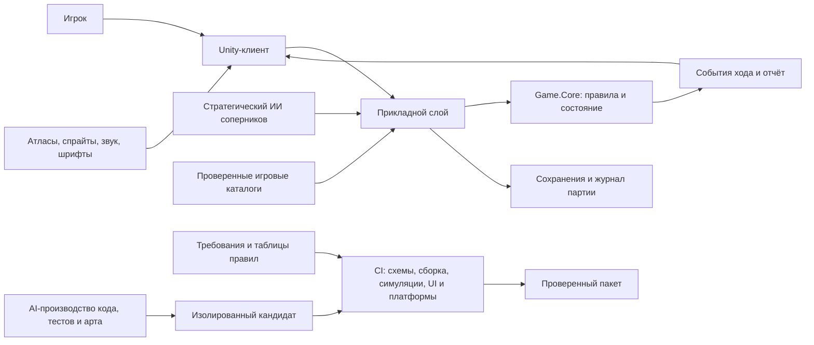
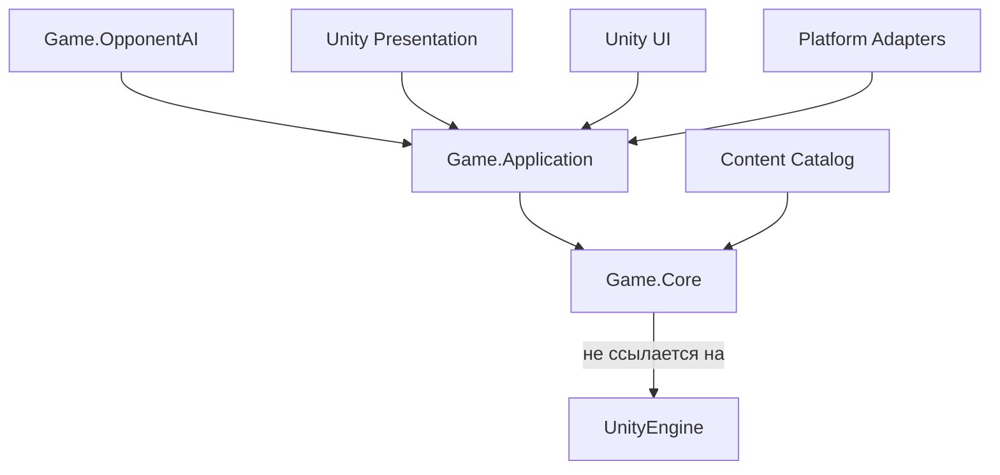

# JERICHO: техническая архитектура и AI-производственный конвейер

**Версия:** 0.1 — техническая спецификация для согласования  
**Связанный документ:** [Игровой и продуктовый дизайн v0.2](game_design_spec_v02_ru.md)  
**Целевые платформы:** iOS, Android  
**Тип игры:** однопользовательская пошаговая 4X-стратегия, офлайн  
**Статус:** рекомендуемая архитектура; версия движка, лицензии, устройства для тестирования и коммерческие параметры уточняются при старте производства.

> Документ отвечает на вопрос, как сделать JERICHO таким, чтобы генеративные инструменты могли производить код, графику и тесты в повторяемом процессе, а результат проверялся обычными детерминированными средствами. Он не утверждает, что языковая модель способна сама гарантировать качество: решения модели проходят сборку, автоматические проверки и контроль человеком.

## 0. Короткое архитектурное решение

Рекомендуемая основа — Unity 6 LTS с C#, при этом правила игры живут в переносимом доменном ядре без ссылок на Unity. Unity отвечает за ввод, экран, звук, анимацию, импорт арта и платформенные функции. Ядро считает партию в обычном C# и может запускать сотни партий без рендеринга. Это позволяет тестировать баланс и правила без телефона и без визуальной сцены.

Карта и города рисуются в лёгкой 2D/2.5D изометрической манере: ромбовидная проекция гексов, слои земли, декора и объектов, составные города из переиспользуемых элементов. ИИ создаёт отдельные спрайты и варианты зданий, а не картинку целой карты: игра собирает сцену из проверяемых модулей, поэтому объект можно выбрать, подсветить, анимировать, локализовать и повторно использовать.

Во время партии соперниками управляет встроенный детерминированный стратегический ИИ, работающий офлайн на том же наборе команд, что и игрок. Генеративная модель не вызывается из игры. Отдельный производственный AI-конвейер может предлагать и создавать код, иллюстрации, данные и тесты; его результаты фиксируются в Git, сопровождаются манифестами и допускаются в сборку только после независимых проверок.

### Базовые решения

| Область | Рекомендуемое решение | Причина |
|---|---|---|
| Игровой движок | Unity 6 LTS, конкретный patch-номер фиксируется в репозитории | зрелая мобильная сборка, C#, распространённые средства автоматизации и тестирования |
| Граница логики | отдельный переносимый пакет `Game.Core`, без `UnityEngine` | детерминизм, headless-прогоны, понятная тестовая поверхность |
| Визуал | 2D/2.5D, URP 2D, изометрическое отображение гексов | простые переиспользуемые изображения и хорошая читаемость на телефоне |
| UI | uGUI + TextMeshPro для мобильных экранов и локализованного текста | зрелый ввод касанием и предсказуемый контроль размеров |
| Формат правил | схема JSON для исходных таблиц; проверка при импорте; сборочные бинарные каталоги | текстовые данные можно генерировать, сравнивать и валидировать |
| Сохранение | локальный версионируемый снимок состояния + журнал команд | офлайн-продолжение, диагностика, воспроизведение партии |
| Случайность | seed партии и отдельные детерминированные потоки | воспроизводимость карты, событий и тестов |
| ИИ противника | utility/goal planner на общих игровых командах | работает без сети, прозрачен в отладке, не читает скрытые данные |
| Генерация | AI создаёт исходники и кандидаты арта; CI проверяет и пакует | ни один вывод модели не становится релизом автоматически |

Система рассчитана на рамки GDD v0.2: карта 13×13 гексов, четыре цивилизации, 45–65 целевых ходов, до 80 ходов, пять эпох, локальная кампания без обязательной сети. Архитектура не должна предполагать, что масштаб останется именно таким: размеры хранятся в настройках режима, но производительность и интерфейс сначала оптимизируются для указанного масштаба.

## 1. Что значит «ИИ полностью генерирует игру»

Здесь есть две разные системы, которые нельзя смешивать.

1. **Игровой ИИ** выбирает действия соперников в запущенной партии. Он должен быть быстрым, предсказуемым, воспроизводимым и доступным офлайн. Это обычный программный алгоритм с эвристиками и оценками.
2. **Производственный AI-конвейер** помогает создавать исходный код, таблицы, изображения, локализацию и тестовые сценарии. Это инструменты разработки. Они могут быть недетерминированными, но обязаны выдавать версионируемые результаты с происхождением и проверками.

Нельзя передавать игровое состояние внешней генеративной модели на каждом ходе: это создаёт сетевую зависимость, стоимость, задержки, несопоставимые партии, утечку данных и невоспроизводимые ошибки. Также нельзя считать заявление модели «тесты прошли» доказательством. Истиной для релизного допуска служат результаты фиксированных команд CI, а не текстовое объяснение агента.

### Цели архитектуры

- Любой игровой результат можно повторить по версии правил, seed и журналу команд.
- Любое правило имеет один основной источник и понятный путь от спецификации до кода и теста.
- Игровые данные проверяются до попадания в сборку; ошибочный контент не маскируется fallback-значениями.
- Код, арт и тесты генерируются небольшими проверяемыми изменениями, а не заменой больших непрозрачных файлов.
- ИИ-соперник пользуется теми же правилами, бюджетом и видимой информацией, что и человек.
- Сборка может быть создана без живой сессии автора и без ручного кликанья по сценам.
- Сбой воспроизводится с seed, состоянием, командой и диагностическим отчётом.

## 2. Контекст системы



В клиенте нет авторитетной копии правил. UI формирует намерение, прикладной слой валидирует и передаёт команду ядру, ядро изменяет состояние и возвращает события. Интерфейс отображает их. Нажатие кнопки не должно напрямую менять население, ресурсы или владельца клетки в UI-коде.

**Граница доверия:** модель генерации не подписывает и не публикует сборки. CI-агент получает ограниченные права на ветку/рабочую область. Хранилище подписывающих ключей и учётные данные магазинов доступны отдельному релизному процессу, а не агенту генерации.

## 3. Стек и технологические решения

### 3.1 Unity и альтернативы

Для этого проекта выбирается Unity 6 LTS как рабочая рекомендация. Godot также подходит для небольшой 2D-стратегии и имеет текстовые ресурсы, но здесь важнее зрелый мобильный build-процесс, C#-экосистема, большой выбор инструментов импорта графики и возможность найти специалистов на поддержку проекта. Это не утверждение, что Unity автоматически делает игру быстрее или лучше.

Перед первым вертикальным срезом фиксируются точный Unity Editor patch, версии пакетов, Android SDK/NDK, Xcode и .NET/C# profile. CI и рабочие станции используют одинаковые версии. Обновление движка проводится отдельным PR с повторной полной валидацией. Версии не обновляются незаметно через диапазоны `latest`.

### 3.2 Рендеринг и UI

- URP 2D с камерой в ортографической проекции; карта использует слои и sorting groups.
- Гексы рисуются из тайловых/спрайтовых атласов. Декорации и городские здания размещаются отдельными объектами с привязкой к координате клетки.
- Для простых подсветок, границ, маршрутов и тумана используется шейдер или процедурная геометрия, а не генерация отдельного изображения на каждую клетку.
- uGUI отвечает за панели города, дипломатии, хода, отчёта и настроек; текст проходит через единый слой локализации и TextMeshPro.
- UI масштабируется от базовой безопасной области, учитывает вырезы, системные панели и минимальную интерактивную область. Точный целевой минимум касания задаётся дизайн-системой при прототипе и автоматически проверяется скриншотами.
- Карта и интерфейс разделены: изменение HUD не требует перестройки модели мира.

Не рекомендуется строить города и гексы из тяжёлых 3D-моделей для текущего объёма. 3D увеличит стоимость арта, освещения, производительности и тестирования на телефонах без явного преимущества для выбранной плоской иллюстрации.

### 3.3 Пакеты и инфраструктура

Минимальный набор: Unity Test Framework, стандартная система сборок Unity, CI-раннер с лицензированным Unity Editor, .NET SDK для быстрых вспомогательных инструментов и Git LFS для крупных исходных изображений/аудио. Конкретный CI-провайдер выбирается при создании репозитория; схема ниже не зависит от одного облачного сервиса.

Addressables нужны только если появится контент, который действительно загружается отдельно после релиза. Для базовой офлайн-версии предпочтительны обычные включённые в сборку атласы и каталоги: меньше состояний загрузки, проще тестирование и гарантия работы без сети.

### 3.4 Сборка portable Core

Практическая схема для одного исходного кода: `Game.Core` оформлен как локальный Unity package с `.asmdef` и одновременно имеет небольшой `.csproj` для `sim-runner` и быстрых headless-тестов. Обе оболочки компилируют одну папку исходников, не копии логики. Целевой API — согласованный с выбранным Unity профилем `netstandard2.1`/поддерживаемый Unity C# profile; точные версии и функции языка фиксируются на этапе создания проекта.

Core использует только BCL-подмножество, доступное обоим компиляторам. Запрещённые зависимости: `UnityEngine`, плагины рендеринга, файловая система из доменных правил, глобальные часы, системный RNG, reflection-подключение модов и сетевые вызовы. Текущие время и случайные значения передаются в функции явными аргументами. CI компилирует пакет обоими путями и запускает replay smoke, чтобы ловить несовместимость профиля Unity с .NET runner.

Если dual-target на фактическом Unity profile создаёт расхождение или дорогой уход, запасной вариант — запускать fast tests через Unity batchmode. Это решение пересматривается на вертикальном срезе, а не после написания всей игры.

## 4. Структура репозитория и границы модулей

```text
Assets/
  Game/Bootstrap/                 # минимум сцен, композиция запуска
  Game/Presentation/              # карты, камеры, анимации, звук
  Game/UI/                         # экраны и представления
  Game/Platform/                   # магазин, файлы, haptics, безопасные адаптеры
  Game/Generated/                  # импортированный runtime-контент; не редактировать руками
Packages/com.legacy.game-core/     # портируемые правила и модели
  Runtime/                         # Game.Core, Application, Content API
  Tests/                           # Unity tests для интеграции в Unity
Config/
  schemas/                         # JSON Schema и версия схемы
  rules/                           # технологии, здания, политики, юниты, эпохи
  locales/                         # словари интерфейса и контента
  modes/                           # параметры кампании и обучения
Art/
  source/                          # исходные файлы и референсы
  generated/                       # принятые AI-кандидаты и manifest
  style/                           # style bible, палитра, эталонные листы
Audio/source/                      # исходные аудиофайлы и лицензии
Tools/
  content-validator/               # схемы, ссылки, балансовые проверки
  asset-pipeline/                  # manifest, изображения, атласы, отчёты
  sim-runner/                      # headless кампании и выгрузка метрик
  build/                           # воспроизводимые команды сборки
  ai/                              # task templates, правила агентов, промпты
Tests/
  Core.Unit/                       # быстрые проверки чистых правил
  Core.Properties/                 # инварианты и случайные допустимые состояния
  Gameplay.Integration/            # цепочки нескольких систем
  Replays/                         # фиксированные seed и журналы команд
  Balance/                         # кампании, метрики и пороги
  Assets/                          # валидация контента и арта
  UI/                              # снимки экранов и взаимодействия
Docs/
  product/                         # утверждённые продуктовые решения
  architecture/                    # эта архитектура и ADR
  requirements/                    # идентификаторы требований и трассировка
```

`Generated/` и результаты сборки не становятся источником истины. Если таблица генерируется из YAML/JSON, меняется исходная таблица и генератор; сгенерированный C# или бинарный каталог повторно создаётся одной командой. Unity-сцены не являются основным местом для логики: игровые системы не кодируются вручную в графе объектов сцены.

### Направление ссылок



Core не знает о камере, `GameObject`, кадрах, touch events, звуке или файлах. Unity-адаптер передаёт данные в Core, затем отображает результат. Это позволяет агенту кода безопасно менять алгоритм экономики без изменений в сценах.

## 5. Игровое ядро: состояние, команды и события

### 5.1 Модель

Для масштаба 13×13 достаточно явной модели доменных сущностей, а не полноценного ECS. Все основные сущности имеют стабильные идентификаторы и принадлежат `WorldState`:

- `WorldState`: номер хода, seed, версия правил, карта, цивилизации, договоры, активные кризисы и итоги.
- `HexCell`: координата, тип, высота/биом, ресурс, владелец, улучшение, повреждение и разведочная информация игрока.
- `CivilizationState`: игрок/ИИ, эпоха, казна, политическое влияние, репутация, доверие/напряжение, отношения.
- `CityState`: население, здоровье, безопасность, пищевой запас, рабочие назначения, очередь проекта, инфраструктура, локальная экономика.
- `UnitState`: класс, координата, владелец, здоровье, снабжение, приказ и состояние перемещения/осады.
- `TradeRoute`, `Treaty`, `MigrationFlow`, `CrisisState`: отдельные сущности с жизненным циклом и ссылками по ID.
- `VisibilityState`: отдельно хранимые для каждого игрока известные территории и свежесть разведданных.

Состояния разделяются на: **авторитетное состояние** партии; **производный read model** для UI и ИИ; **presentation state** анимаций, выбранного объекта и камеры. Read model может кэшироваться и пересчитываться, его нельзя сохранять как второй независимый источник истины.

Все числа правил используют целочисленную точность: например, деньги в десятых долях базовой единицы, здоровье в целых пунктах, проценты в basis points или целых сотых. В доменном коде не используется `float`/`double` для порядка действий, стоимости, порогов победы, миграции или боевого расчёта. Графика может использовать float, поскольку она не влияет на результат.

### Владение игровыми системами

Таблица фиксирует границы модулей и ключевое правило «один владелец записи»: другая система не исправляет состояние напрямую, а формирует команду/входной факт для владельца.

| Модуль | Основные входы | Что он единолично изменяет | Что не должен делать |
|---|---|---|---|
| `WorldGeneration` | seed, режим, каталог местности | исходную карту, старты и скрытый ресурсный слой | выбирать победителя, знать будущие ходы |
| `MapAndVisibility` | команды обзора, центры городов, отряды | видимость, разведанные данные, свежесть наблюдений | изменять полную карту из UI/AI view |
| `Settlement` | команда основания, доступная клетка | город, центр, начальную структуру | бесплатно создавать население/ресурсы вне правил поселенца |
| `CityWork` | население, роли, клетки, улучшения | назначения, производство города, прогресс проекта | списывать государственный бюджет или менять дипломатические отношения |
| `EconomyAndBudget` | выпуски, налоги, содержание, сделки | казну, общегосударственные потоки и бюджетные долги (если разрешены) | менять людей или боевую силу напрямую |
| `FoodHealthMigration` | городские выпуски, запасы, маршруты, безопасность | еду, здоровье, городское население, потоки и исходы миграции | проводить бой или менять границы |
| `TechnologyAndPolicy` | научный выпуск, требования, решения | прогресс знаний, эпоху, законы и активные слоты | напрямую выдавать валюту/победу без общего эффекта |
| `TradeAndDiplomacy` | отношения, маршруты, предложения, договоры | договоры, торговые права, репутацию, кризисы | считать потери в бою |
| `Military` | отряды, маршрут, рельеф, снабжение, приказ | положение/силу войск, бои, осады, блокаду | присваивать город без предусмотренной процедуры |
| `EventsAndRecovery` | подтверждённые триггеры и история | состояние события, выбор и временные обязательства восстановления | применять незапрошенную случайность без записи seed/причины |
| `VictoryEvaluator` | подтверждённые показатели завершённого хода | состояние завершения и результат партии | менять экономику для создания победного условия |

Если эффект проходит несколько подсистем, у него есть явный маршрут. Например, санкция за нарушение договора создаётся `TradeAndDiplomacy` как факт, затем через `TurnEvent` передаётся владельцам бюджета/торговли/репутации. Она не должна напрямую патчить `CityState`, `Treasury` и `MigrationFlow` в одном обработчике.

### 5.2 Команды и события

Прикладной слой принимает типизированные команды: `FoundCity`, `SetCityProject`, `AssignWorker`, `ProposeTreaty`, `MoveUnit`, `SetTaxPolicy`, `EndTurn` и т. п. Команда содержит стабильный `CommandId`, `ActorId`, цель, параметры и ожидаемую версию состояния. Ядро проверяет полномочия, видимость, доступность цели и стоимость. Невалидная команда возвращает ошибку без частичного изменения состояния.

Команда, прошедшая проверку, приводит к доменным событиям: `CityFounded`, `PopulationMoved`, `FoodConsumed`, `UnitMoved`, `BattleResolved`, `TreatyBroken`, `MigrationStarted`, `TurnCompleted`. Событие фиксирует фактическую причину и численное изменение. Отчёт хода, уведомления UI и журнал реплея формируются из события, а не вычисляют причину повторно.

Контракт ответа прикладного слоя имеет три исхода: `Accepted` с идентификатором обработанной команды и событием/списком изменений; `Rejected` с стабильным кодом причины и локализационными параметрами; `Conflict` при устаревшей версии состояния или повторном несовместимом действии. Текст ошибки не является строковым решением в Core: Core возвращает, например, `insufficient_food` и `required=6`, UI отображает локализованное сообщение.

Команда может иметь `Preview`/dry-run путь, который вычисляет доступность и прогноз затрат без изменения мира. Предварительный прогноз помечен как прогноз: он не резервирует ресурс и может измениться, если одновременно разрешится приказ другой цивилизации. Истинный результат существует только после commit хода.

События не обязаны быть глобальным event-sourcing хранилищем. Источником состояния остаётся компактный снимок `WorldState`; последовательность команд и существенных результатов хранится как журнал для воспроизведения и диагностики. Это проще для сохранения мобильной партии и даёт повторяемость.

### 5.3 Ошибки и атомарность

Разрешение одного хода выполняется как транзакция в памяти: создаётся рабочая копия или журнал обратимых изменений; выполняются фиксированные стадии; проверяются инварианты; только затем новый snapshot становится текущим. При критическом нарушении ход не сохраняется, а отладочная сборка выводит нарушенный инвариант, seed и журнал. В релизе безопасный экран сообщает о проблеме сохранения и предлагает восстановить последний согласованный autosave. Ошибки пользовательского приказа не являются критическими: команда просто отклоняется с понятным объяснением.

Операции разделены на `Validate → Plan → Apply → Verify → Commit`. `Plan` определяет изменения и список доменных событий без записи; `Apply` применяет один план к рабочему состоянию; `Verify` проверяет инварианты; `Commit` меняет текущую ссылку состояния и пишет реплей/autosave. Команды отдельных фаз не сохраняются по одной, чтобы игрок не получил половину хода при завершении приложения.

### 5.4 Инварианты модели

Минимальный набор инвариантов, который проверяется после каждой стадии в debug/QA сборках и в тестах:

- идентификаторы сущностей уникальны, все ссылки разрешаются;
- клетка имеет не более одного владельца, город имеет ровно одного владельца;
- население города, войск и обозов не становится отрицательным; миграционные исходы явно учитывают исчезновение людей при смерти/катастрофе;
- ресурсы меняются через зарегистрированные источники и расходы; отрицательный баланс допускается только для явно заданной кредитной/долговой механики;
- город не может назначить одного человека дважды; каждая рабочая клетка имеет максимум одного работника;
- отряд не перемещается через запрещённую местность, границу без права прохода или непроверенную командой дальность;
- технологии и проекты соблюдают требования эпохи и предусловия;
- укрупнение/разделение населения при поселенце сохраняет людей и пищу согласно правилу проекта;
- один и тот же seed, каталог правил, версия Core и команды дают одинаковый `StateHash`.

Конкретные числовые инварианты согласуются с GDD. Если правило допускает исключение — оно перечисляется в таблице правил, а не добавляется как невидимый `if` в код.

## 6. Детерминизм, ходы и воспроизведение

### 6.1 Случайность

У каждой партии есть `WorldSeed`. Псевдослучайный генератор реализуется в Core и не зависит от `System.Random`, порядка потоков Unity или платформенной реализации. Генератор разбивается на именованные потоки, например `map`, `events`, `combat`, `ai-civ-03`; изменение броска для события не должно переставлять весь будущий мир. Поток и его состояние сериализуются либо детерминированно выводятся из seed, хода, подсистемы и порядкового номера.

При равном весе выбор кандидата производится по отсортированному стабильному ID, затем по именованному случайному потоку. Нельзя полагаться на порядок `Dictionary`, файловой системы, параллельного цикла или списка Unity-компонентов. Внутри каждого хода расчёты выполняются последовательно и в документированном порядке; параллельно можно выполнять независимые симуляционные партии, но не части одной партии, которые изменяют общее состояние.

### 6.2 Одновременные приказы и фазы разрешения

Пользователь подтверждает один набор приказов. Каждый ИИ строит собственный набор, видя только информацию, которую разрешает его туман войны. Наборы фиксируются до применения. Затем Core разрешает ход по порядку из GDD: проверка и резервирование → бюджеты → производство → перемещение/бои → снабжение/осады → пища/рост/здоровье/занятость → миграция и доверие → договоры/кризисы/события → победа, отчёт и snapshot.

До фиксации хода изменение пользовательского проекта может отменить прежний приказ, а не создавать дублирующую очередь. После `EndTurn` команда идемпотентна по ID: повторная доставка не рассчитывает тот же ход второй раз. Одновременно подтверждённые перемещения разрешаются по публичному стабильному правилу приоритета и tie-break, задокументированному в правилах боя; случайные ничьи используют назначенный боевой поток.

Рекомендуемая реализация `TurnResolver` выглядит как явный список стадий, а не цепочка неявных callback-ов:

```text
resolveTurn(world, playerOrders, aiOrders): TurnResult
  assert phase == Planning
  validate all orders; reserve/settle order costs
  working = copyOrJournal(world)
  run BudgetSystem(working)
  run CityProductionAndResearch(working)
  run MovementAndCombat(working, lockedOrders)
  run SupplySiegeAndDamage(working)
  run FoodGrowthHealthEmployment(working)
  run MigrationTrustAndReputation(working)
  run TreatiesEventsAndCrisisChoices(working)
  run VictoryEvaluation(working)
  assert all required invariants
  emit TurnCompleted and report groups
  commit working; advance turn; write replay hash and autosave
```

Это псевдокод порядка, не спецификация конкретных формул. До первой реализации для каждой стадии создаётся контракт: какие поля уже обновлены, какие поля она читает, какие события пишет и как обрабатывается исключение. Не допускается, чтобы `CityProductionAndResearch` повторно пересчитывал результат после миграции, если такое повторение не является явным правилом.

### 6.3 Журнал реплея

`ReplayHeader`: версия игры, версия правил, seed, параметры режима, ID карт/контента.  
`ReplayTurn`: команды всех сторон в зафиксированном порядке, контрольный хэш после хода, выборы случайных потоков при необходимости.  
`ReplayDiagnostic`: события смерти, боя, миграции и кризисов, полезные для QA.

Полный журнал включается в разработческие/QA сборки. В релизе можно хранить компактный журнал текущей партии с ротацией или только последние N ходов, если размер сохранения окажется существенным. При рассинхроне replay runner выдаёт первый ход, где разошёлся хэш, и diff сущностей. Это важнее, чем сообщение «партия ведёт себя по-разному».

## 7. Карта и представление

### 7.1 Координаты

Логика использует осевые координаты гекс-сетки `(q, r)` и целочисленное расстояние гексами. Рендерер преобразует координаты в экранные независимо от логики. Для альбомной композиции базовый вариант — flat-top гексы, однако ориентация считается визуальным параметром и проверяется на телефоне. Области карты, непроходимые клетки, высоты и дороги не кодируются в изображении: они находятся в `HexCell`.

Карта 13×13 — структура с размерами из `GameModeConfig`; тесты должны прогонять также уменьшенный обучающий мир и стрессовый размер для будущего расширения. Игрок двигает карту панорамированием, масштабирует жестом, тап выбирает объект, долгий тап открывает краткую подсказку. Координаты камеры и выбранная клетка относятся к presentation/UI state и сохраняются отдельно от состояния партии либо не сохраняются вовсе.

### 7.2 Видимость

Внутренняя карта хранит полное состояние. `PlayerMapView` формирует видимое игроку состояние с текущими наблюдениями, разведанной историей и неизвестными клетками. AI, интерфейс и аналитика игрока получают этот view, а не ссылку на внутреннюю карту. Это одновременно поддерживает туман войны и тестирует, что обычная сложность не пользуется скрытой информацией.

### 7.3 Производительность карты

13×13 гексов не требует сложной потоковой подгрузки. Карта должна обновлять только изменившиеся чанки/объекты: смена одного владельца не должна пересобирать весь рендер сцены. Используется object pooling для маркеров, юнитов и анимированных эффектов. Оценка нагрузки включает UI, эффекты, анимации и атласы, а не только пустую карту.

### 7.4 Генератор и валидатор мира

`WorldGeneration` состоит из чистых функций со входным `WorldSeed` и профилем режима. Стадии соответствуют GDD: форма континентов → высота/реки → биомы → редкие ресурсы → стартовые зоны → проверка еды/сырья/выхода → коррекция справедливости. Каждая стадия выдаёт промежуточный артефакт и диагностические показатели, чтобы генератор можно было тестировать без сцены.

Проверка старта использует одинаковую функцию потенциала для всех игроков. Минимумы из GDD должны проверяться как жёсткие ограничения: четыре пригодные пищевые клетки в заданном радиусе, источник сырья, доступ к воде или эквивалентной еде, хотя бы один безопасный путь расширения, не более одного полного узкого блокирующего выхода. Разница стартового потенциала выше 20% приводит к повторной расстановке/коррекции. Число повторов ограничено конфигом; при исчерпании лимита генератор применяет документированную локальную коррекцию или возвращает `MapGenerationFailed` с seed, а не создаёт карту, которая нарушает гарантию.

Детерминированный тестовый corpus включает принятые seed карт, граничные рельефы и seed, ранее вызвавшие дефект. Валидатор после генерации отдельно доказывает достижимость пути и расстояние между поселениями. Ошибка качества содержит координаты/причину (например, «старт civ-02 имеет 3 из 4 доступных пищевых клеток») и сохраняет входной seed для воспроизведения.

## 8. Данные и единый источник правил

### 8.1 Авторство данных

Дизайнерские таблицы хранятся в небольших YAML или JSON файлах с обязательной схемой и стабильными ID. На старте проекта выбрать один редактируемый формат; рекомендация — JSON для полной поддержки JSON Schema и простого парсинга на инструментах. Если команде важна компактность редактирования, использовать YAML как авторский формат, но собирать его в канонический JSON до валидации. Не поддерживать два равноправных источника одних и тех же чисел.

Пример технологии:

```json
{
  "id": "tech.public_health",
  "era": "era_03",
  "cost": 42,
  "prerequisites": ["tech.irrigation"],
  "effects": [
    {"kind": "city_health_add", "value": 2},
    {"kind": "unlock_building", "targetId": "building_clinic"}
  ],
  "localizationKey": "TECH_PUBLIC_HEALTH"
}
```

Это не означает, что любой игровой эффект можно описать произвольным скриптом в JSON. Каталог использует закрытый перечень типизированных эффектов, который парсер проверяет. Правило с новой семантикой требует изменения Core, теста и схемы; данные не могут исполнять код или выражения из строки.

### 8.2 Что хранится в каталоге

- типы местности, ресурсные признаки и модификаторы;
- роли работников, здания и инфраструктура;
- технологии, эпохи, требования и эффекты;
- законы, налоги, расходы и кризисы;
- боевые характеристики, снабжение и дипломатические условия;
- победные цели и пороги;
- параметры карты, обучения, трудности и стартовых наборов;
- текстовые ключи локализации, иконки, звуки и иллюстрации.

### 8.3 Валидация контента

Перед запуском редактора и сборкой валидатор проверяет JSON Schema, уникальность ID, наличие ссылок, циклы/невозможные prereq-цепочки, стоимость и диапазоны, разрешённые комбинации эффектов, все ключи локализации, названия ассетов и отсутствие неиспользуемых записей. Балансовые ограничения задаются явно: например, каждая технология достижима, каждый обязательный проект имеет валидный unlock-путь, у каждого типа клетки есть допустимое изображение.

После импорта создаётся `ContentCatalog` с `ContentVersion` и хэшем содержимого. Партия привязана к версии каталога. Изменение экономики без увеличения совместимой версии правил не должно незаметно менять уже сохранённую игру.

### 8.4 Трассировка

Каждое правило получает ID требования вида `POP-`, `ECO-`, `WAR-`, `DIP-`, `AI-`, `UI-`, `ART-`, `SAVE-`. Таблица трассировки указывает источник решения, модуль, данные, автоматические тесты, ручной критерий приёмки и статус. AI-агент не может считать задачу выполненной, если требование изменено без обновления теста или обоснованной отметки `manual-only`.

На одно требование должна приходиться строка, которую можно разобрать машиной, например:

```json
{
  "requirementId": "POP-MIG-014",
  "source": "Docs/product/game_design_spec_v02_ru.md#population-migration",
  "owner": "FoodHealthMigration",
  "dataIds": ["migration.war_pressure", "migration.minimum_flow"],
  "testIds": ["Migration_WarPressure_EmitsReasonedFlow", "Migration_ConservesPopulation"],
  "manualAcceptance": ["UX-MIG-03"],
  "status": "approved"
}
```

Путь на примере иллюстративный, его нужно создать с фактической структурой Docs. Проверка CI требует, чтобы тестовые ID существовали, статус был допустимым, а ссылка на источник открывалась. Это превращает трассировку в проверяемые данные, а не презентационный список.

## 9. Экономика, население и причинная модель

Точные формулы остаются предметом GDD и балансировки; архитектура фиксирует, как их реализовывать так, чтобы они были проверяемы и понятны.

### 9.1 Расчёт города

Городской расчёт работает как отдельный детерминированный шаг с явным входом и выходом. Вход: население, еда, занятость, клетки, инфраструктура, налоги, законы, здоровье, безопасность, снабжение и торговые потоки. Выход: производство по типам, расходы, запас еды, здоровье, рост/убыль, зарплаты/бюджет, удовлетворённость и причины изменений. Внутренние стадии задаются фиксированным порядком, чтобы не возникла циклическая логика «экономика меняет людей, люди меняют экономику» внутри одного расчёта.

Каждое изменение населения представляет собой `PopulationDelta` с кодом причины: рост, добровольная миграция, вынужденное перемещение, потери, основание города, мобилизация, возвращение беженцев. Для миграции хранятся источник, назначение или потеря, численность, причина, направление и длительность. Не сводить все потери к одному отрицательному числу: иначе игрок не сможет понять их и QA не сможет проверить причинность.

### 9.2 Экономические потоки

Каждый ресурс имеет перечень источников и расходов. Дневник/отчёт строится по операциям: налоговый сбор, содержание армии, содержание институтов, торговый доход, производство, расходы проекта, импорт пищи, потери маршрута. Для суммы за ход должна выполняться формула:

`баланс_после = баланс_до + сумма(поступления) − сумма(расходы)`.

Для еды отдельно ведутся производство, импорт/экспорт, потребление, порча/потеря и изменение запаса. Транзитная еда не может одновременно считаться городским запасом и грузом маршрута.

### 9.3 Миграция между системами

Алгоритм миграции получает оценки «выталкивания» из города и «притяжения» городов назначения по здоровью, безопасности, занятости, пище, законам, торговле и последствиям конфликта. Для основной версии используется агрегированная численность с точностью до 0,1 единицы населения, как задано в GDD, а не агенты-граждане. В домене это целое число десятых. Кандидаты назначения фильтруются по доступности маршрута/границ; затем рассчитываются веса. Результат и его причина записываются в событие.

При одинаковом наборе кандидатов порядок и пропорциональное распределение фиксированы. Округление остатков передаётся по стабильному правилу (например, крупнейшая дробная часть и стабильный ID города). При слабом потоке может сработать порог минимальной численности, но отложенная миграция должна сохранять накопленное давление или явно обнуляться по правилу.

Такое разделение даёт отдельные тесты: источник уменьшился ровно на число уехавших; назначения получили ровно это число; погибшие/потерянные учтены отдельно; договоры открытых границ влияют на допустимость; война/осада изменяет давление согласно правилам, а не произвольной случайной проверке.

## 10. Боевые действия и санкции за войну

Война не должна существовать как отдельный слой, который обходит экономику. Команда `DeclareWar`/факт войны изменяет дипломатическое состояние; последующие боевые события создают обязательства и последствия в общем состоянии: бюджет, снабжение, торговые маршруты, население, доверие, безопасность и восстановление.

Бой разрешает Core по фиксированному алгоритму. Вход явно включает характеристики отрядов, рельеф, укрепления, снабжение, состояние, поддержку, истощение и боевой random stream. Выход — потери, отступление/контроль, повреждение инфраструктуры и событие с разбором вкладов факторов. Расчёт должен создавать объяснение для отчёта вида «потери из-за нехватки снабжения / обороны на холме», а не только число.

### 10.1 Единый учёт последствий конфликта

- **Людские потери и эмиграция:** прямые потери, перемещённые жители и гражданская миграция — разные категории и разные события.
- **Экономика:** мобилизационные расходы, содержание армии, повреждённая инфраструктура, блокада и потерянная торговля учитываются в книге потоков.
- **Общественное состояние:** доверие, репутация, безопасность, здоровье и престиж меняются от конкретных событий, с указанными источником и сроком восстановления.
- **Послевоенное восстановление:** долг/повреждения/беженцы/нарушенные договоры имеют состояния, длительность и пути восстановления. Не делать санкцию бессрочной без явной игровой причины.
- **Дипломатия:** нарушение договора и нападение на нейтральную цель меняют отношения по тем же типизированным событиям, которыми пользуется UI.

Структура позволяет будущей версии менять жесткость наказаний через данные, но не удалять взаимосвязь систем. Она также позволяет считать метрики: долю населения, покинувшую зону войны; ходы до восстановления; суммарную потерю торговли; частоту войны как способа оптимальной победы.

## 11. ИИ-соперники во время партии

### 11.1 Не языковая модель, а планировщик

На каждую цивилизацию запускается отдельная политика. Она принимает `PlayerMapView`, доступный бюджет и каталог разрешённых действий, а возвращает команды. В сложностях меняются дальность планирования, точность оценки, качество приоритетов и стартовые условия только там, где это разрешено GDD. На обычной сложности запрещены скрытые ресурсы, дополнительный доход и знание неизвестной армии.

### 11.2 Предлагаемая структура

1. **Наблюдатель:** строит факты из видимой карты и отчёта игрока, помечает устаревшие разведданные.
2. **Оценщик состояния:** считает голод, риск миграции, слабые места обороны, экономическое здоровье, готовность следующей эпохи и вероятность победных целей.
3. **Стратегический планировщик:** выбирает 1–2 цели на несколько ходов, например «стабилизировать пищу», «открыть технологию», «завершить культурный проект», «защитить проход», «предложить торговый договор».
4. **Тактические оценщики:** выбирают проект города, работников, перемещение юнитов, дипломатическое предложение, налог/политику.
5. **Проверка команд:** перед применением план отправляется через те же валидаторы Core. Незаконная команда отклоняется и добавляется в диагностический отчёт.

Цель получает оценку utility: полезность по текущим метрикам + ожидаемый прирост победной цели − риск/стоимость − конфликт с предыдущим обязательством. Начальная версия может использовать score-based кандидаты и ограниченный поиск на 1–3 хода. Полноценный Monte Carlo Tree Search пока не нужен: размер состояния, туман войны и долгосрочные последствия миграции делают эвристику проще для отладки. После сбора результатов можно рассмотреть поиск для отдельных решений.

### 11.3 Планирование городов и стратегии

Приоритеты не хардкодятся случайными if-ами в одном классе. Действие имеет тип, оценку, предусловия, расходы, ожидаемые последствия и объяснение. Например, «город испытывает дефицит еды» повышает оценку фермы/торговли/перераспределения, но не обходит стоимость. Стратегия победы задаёт долгосрочную цель, но планировщик пересматривает её, если безопасность и население в критическом состоянии.

ИИ симулирует на том же Core и использует итоговый отчет собственного города. В отладочной сборке можно открыть «почему выбран ход»: выбранная цель, лучшие альтернативы и причина отказа. Игроку эти детали не надо показывать в полном объёме, но понятность действий противника важна для доверия.

#### Реализованный планировщик в текущем прототипе

Фактическая версия использует оценку кандидатов в `TurnResolution`, а не поиск по дереву. Соперник выбирает одну из семи целей: наука, торговля, культура, качество жизни, оборона, восстановление или расширение. Фиксированный архетип задаёт стартовый уклон; seed и цивилизация меняют исследовательскую последовательность, хозяйственные решения и портфель зданий. На Calm и Standard профиль победы тоже зависит от seed. На Strong и Trial архетип закрепляет узнаваемые планы: Учёный готовит науку, Торговец — международные связи, Стратег безопасности — качество жизни. План направляет исследования, строительство, назначения работников, службы, бюджет и договоры. На одном и том же seed решения воспроизводимы, а соседние карты могут получать другой курс и портфель зданий.

В профилях Calm и Standard у Учёного встречаются наука, качество жизни и культура; у Торговца — дипломатия, наука и качество жизни; у Стратега безопасности — качество жизни, дипломатия и наука. Начальное исследование тоже выбирается по архетипу и seed из доступных веток первого века. Сильные профили сохраняют долгосрочную цель при обычном дефиците, одновременно временно направляя работников на торговлю. Критический голод и активная война всё ещё важнее победной стратегии. Бюджетный контроллер сокращает услуги, когда прогноз выпуска становится отрицательным, и возвращает финансирование после восстановления баланса.

Минимальный срок плана зависит от сложности: около 7 ходов для Calm, 6 для Standard, 5 для Strong и 4 для Trial. Критический голод и активная война позволяют сменить план раньше. Цель влияет на исследование, назначение специалистов, оценку зданий, реформу и дипломатические предложения. Налог повышается при нехватке средств; во время серьёзного дефицита город временно выделяет жителей на торговлю. Город с обычным строительным проектом отдаёт приоритет производству, кроме продовольственной и финансовой аварии. Научный проект сначала ускоряется производством, а после завершения строительства город возвращает жителей к знаниям; остальные города научной цивилизации поддерживают выпуск знаний. Для финальной программы ИИ выбирает город с наибольшим производством.

Планировщик учитывает доступные активные победы: резервирует влияние под профильный проект, может запустить научную программу, фестиваль или коалицию, повторяет истёкшие торговые соглашения, но не повторяет отклонённые предложения каждую итерацию. Коэффициенты экономического выпуска для AI составляют 0,95 / 1,00 / 1,125 / 1,30; Strong получает 5%, Trial — 10% дополнительного темпа исследования, Calm получает до 10% catch-up к науке при отставании более двух технологий. На Strong AI-цивилизации начинают с одной дополнительной единицей административной ёмкости, на Trial — с двумя. Ограничение в четыре города остаётся общим, а поселенец не основывает город сверх текущей административной ёмкости.

Headless-проверка 12 seed-карт дала 8 комбинаций стартовых курсов и 8 стартовых исследований, 12 упорядоченных последовательностей технологий и 12 портфелей зданий за 60 ходов; 17 из 36 соперников хотя бы раз сменили цель в текущей выборке. После обновления дипломатических цен и резерва влияния балансная серия из 32 полных self-play кампаний Strong дала 29 активных побед (4 по благополучию, средний ход 61), а 32 кампании Trial — 32 научные победы (средний ход 59). Это воспроизводимые угрозы активной победы, но результат измерен без ходов игрока и только на стандартном темпе; доля побед против человека и на Quick/Relaxed требует отдельного баланса.

**Текущее состояние реализации (18 октября 2026 года):** ИИ на Strong и Trial может самостоятельно начать войну при подходящих угрозе, силах и отношениях; частота зависит от seed. При выборе цели военный планировщик опирается только на известные клетки и видимую силу войск. Отдельная регрессия меняет скрытые силы защитника при одинаковом наблюдаемом состоянии и проверяет, что это не меняет решение ИИ. Условия мира, посредничество, аннексия оккупированного города, обмен пленными и захват гражданского обоза также присутствуют в ядре. Это уже не ограничивается обороной в начатом игроком конфликте.

Открыты следующие пункты архитектурного плана: полный `PlayerMapView` для каждого решения ИИ (часть планировщика всё ещё читает общее состояние), понятный игроку разбор факторов решения ИИ, полноценная запись и воспроизведение журнала с контрольным хэшем после хода, а также тактический бой. Тактический бой намеренно не входит в выбранную стратегическую модель; первые три пункта нужны для более строгой информационной изоляции и диагностики, но не блокируют прохождение одиночной кампании.

### 11.4 Проверка ИИ

- Набор фиксированных сценариев: голод, осада, соперничество за технологию, открытые границы, выход из войны, нехватка денег.
- Тест на отсутствие скрытой информации: две карты, одинаковые видимые данные, разные невидимые данные не должны менять решение до разведки.
- Стабильность: одинаковый view и seed policy даёт те же команды.
- Self-play по множеству seed: выявлять зацикливание, пустые ходы, неподдерживаемые армии, чрезмерную войну и невозможность достичь каждой цели.
- Сравнение трудности: более высокий уровень в среднем принимает более качественные решения по выбранным метрикам, но не получает запрещённой информации.

Текущие критерии в `Tests/CorePlaythrough`: 16 полных партий на четырёх уровнях сложности; дополнительно 32 Strong и 32 Trial кампании с нижними границами 8/32 и 16/32 активных побед соответственно, минимум четырьмя победами Strong по благополучию и восемью научными победами Trial; серия из 12 seed-карт для разнообразия курсов, исследований, портфелей зданий и смены плана; реакция на голод и дефицит; качество финансирования служб; монотонность экономических коэффициентов; прогресс трёх соперников минимум до эпохи Связанных земель и трёх городов к 70-му ходу. Проверка не доказывает баланс всех карт и темпов.
- Отдельные метрики: победный путь, ходы до победы/лимита, войны на цивилизацию, восстановление после войны, миграция и доля невалидных AI-команд.

## 12. Мобильный клиент и UX-архитектура

### 12.1 Обработка действий

UI использует однонаправленный поток: `Input → Intent → Command → Core Result → View Model → UI`. Панель не вычисляет стоимость в отдельной формуле; доступные кнопки и предварительная оценка строятся из `ActionAvailability` и результата dry-run валидатора. Подсказка причины всегда приходит из домена или отображающего слоя, не дублирующего бизнес-логику.

`EndTurn` — отдельная подтверждаемая операция. Перед ней UI собирает предупреждения из анализатора состояния. Предупреждение не блокирует ход, как задано GDD. После применения показывается короткий отчет по группам причин, а игрок может перейти к городскому, армейскому или дипломатическому объекту из строки отчёта.

### 12.2 Навигация

- Главная карта с постоянными ресурсами, эпохой, целями и кнопкой завершения хода.
- Контекстная панель клетки/города/отряда.
- Полноэкранные панели исследований, законов, дипломатии, победных целей и сводки.
- Журнал хода с фильтрами экономика/люди/дипломатия/армия/события.
- Пауза/сохранение/выход доступны из одного устойчивого места.

Экранные представления не владеют состоянием партии. При закрытии и повторном открытии панели они строятся из view model. Локализация не зашита в координаты: текст может быть длиннее английского/русского исходника, а шрифт имеет fallback для кириллицы и специальных символов.

### 12.3 Автоматизируемость интерфейса

Основные действия получают стабильные automation ID, например `map.end_turn`, `city.select_project`, `diplomacy.offer_treaty`. Тест может активировать действие через UI Automation API или слой тестового ввода, не имитируя пиксельные касания на каждом экране. Отдельные end-to-end тесты обязаны проверять реальный tap/swipe на устройстве/эмуляторе, особенно жесты карты и safe area.

## 13. Графика и AI-пайплайн арта

### 13.1 Арт-направление и единица производства

Для карты используется читаемая иллюстрированная изометрия: простые объёмы, выразительный контур/силуэт, ограниченная палитра, мягкие тени, умеренная фактура, разные материалы и растительность. Гексы и UI должны оставаться различимыми на экране телефона. Итоговый артгайд содержит точную палитру, направление света, угол камеры, перспективу, толщину контура, правила тени и примеры корректного/некорректного масштаба.

Единица генерации — самостоятельный слой: базовая местность, лес, скала, руины, ферма, городской объект, юнит, иконка, иллюстрация события. Нейросеть не генерирует надписи для интерфейса и не выдаёт целый скриншот карты как игровой ассет. Текст, цифры, рамки, маркеры владельца и подсветка строятся нативно, чтобы они локализовались, масштабировались и не содержали артефактов.

### 13.2 Слои композиции

Видимый гекс может состоять из:

1. основание по `terrainId`;
2. вариация подложки по координате/seed карты;
3. экологический декор по биому;
4. ресурсный маркер;
5. улучшение/дорога;
6. принадлежность/граница;
7. городские здания, юнит или временный эффект;
8. контур выбора, туман и маршрут.

Вариант рисунка выбирается детерминированно от координаты и seed, чтобы переход между сохранением/загрузкой не менял композицию. Случайный декоративный слой не закрывает важный UI-символ и не меняет клик-зону.

Город — не одна уникальная AI-картинка на население. Он компонуется из центра, районных зданий, хозяйственных объектов и фоновых деталей. Эпоха меняет ограниченный набор частей, приоритетные постройки видны, размер города имеет несколько детерминированных градаций. Так игрок считывает развитие, а художник не обязан производить изображение для каждого сочетания.

В текущем runtime центр хранится в `CityState.Q/R`, район — в `HexCell.DistrictCityId`, `DistrictBuildingId` и `DistrictLevel`. Проект здания закрепляет свободный гекс, после завершения тот рисуется отдельным эпохальным спрайтом; карточка города показывает координаты района, нажатие выбирает его город. Четыре `NationDefinition` задают лидера, историческую заметку, портрет, имя учебного центра, образ центра города, уникальный район, бонус и AI-архетип. Уникальные районы имеют ограничение по `RequiredNationId`, обычную стоимость содержания и отдельные экономические эффекты. Сохранения со старыми идентификаторами вымышленных фракций переводятся на соответствующие новые ID; завершённые здания размещаются на подходящих клетках при загрузке.

Для первой версии реестр ассетов разделяется как минимум на категории:

| Категория | Ожидаемые варианты | Требования к использованию |
|---|---|---|
| Основание гекса | тип местности × несколько вариаций | бесшовная визуальная стыковка, без букв/иконок |
| Декор местности | лес, камни, вода/берег, болото, руины | прозрачность, pivot, не закрывать кликабельные маркеры |
| Улучшение | ферма, мастерская, дорога и прочие unlocks | читаемый силуэт в пределах клетки, отдельный слой |
| Городские элементы | центр, жильё, наука, культура, производство | эпоха/уровень/сторона может менять tint/вариант, не весь объект |
| Юнит | наземные роли из GDD | единый размер основания и направление взгляда |
| UI-иконки | ресурсы, технологии, политика, состояния | видны в малом размере, локализуемый текст рядом, не встроен внутрь |
| Иллюстрации | лидеры, культурные кампусы и уникальные районы; события, обучение, победа/поражение | прозрачные повторно используемые спрайты; исторический статус и игровой вымысел хранятся в метаданных |

Asset ID — стабильный ключ, не имя файла, которое может часто меняться. Runtime-каталог разрешает ID в imported sprite/material. Удаление/переименование ID требует явного compatibility alias, если старый ID мог попасть в сохранение или сценарий.

### 13.3 Manifest и происхождение

Каждый AI-кандидат сопровождается текстовым sidecar-манифестом:

```json
{
  "assetId": "terrain.forest.variant_02",
  "kind": "sprite",
  "sourcePromptId": "ART-TERRAIN-FOREST-02",
  "generator": "tool-and-model-version",
  "seed": 481726,
  "styleBibleVersion": "0.3",
  "dimensions": [512, 512],
  "alpha": true,
  "pivot": [0.5, 0.18],
  "paletteTokens": ["forest.deep", "leaf.light", "bark.warm"],
  "sourceHash": "sha256:...",
  "status": "candidate"
}
```

Точные размеры указываются в `AssetRequest`, а не копируются из этого примера. Манифест также фиксирует лицензионную/источниковую информацию, применимую к инструменту, и статус проверки. Если исходный файл перегенерирован, новая версия получает новый hash и diff; старый принятый вариант не перезаписывается молча.

### 13.4 Автопроверки арта

Пайплайн проверяет:

- файл открывается, профиль цвета ожидаемый, размер соответствует manifest;
- alpha-канал чистый, край не имеет ореола/случайных пикселей, pivot находится в допустимой области;
- идентификатор и категория совпадают с реестром; нет дубликатов ID;
- размеры, отступы и максимальный atlas budget не превышены;
- перцептивный hash не выявляет случайный дубликат другой записи;
- палитра соответствует допустимой области; контраст важного силуэта относительно основания достаточен;
- слой без намеренного текста не содержит явных букв/знаков (OCR может подсказать, но ручная проверка нужна для сомнительных случаев);
- превью показано на реальной сетке и в размере 1×/2×, а не только на увеличенной картинке.

Визуальная модель или отдельный reviewer может выдать список вероятных проблем: нарушен изометрический угол, несогласованный свет, мелкий силуэт, лишняя тень, нечитаемость на маленьком экране. Это подсказка, а не критерий выпуска. Приёмку эталонных ассетов подтверждает человек; уже принятые варианты становятся lock-reference для генерации соседних элементов.

Для сравнения с style bible полезно строить контактный лист: asset ID, миниатюра на нейтральном фоне, вариант на клетке нужного биома, вариант рядом с соседними владельцами/объектами, отображение в минимальном целевом масштабе. Отчёт хранит hash исходника и версии baseline, поэтому AI-reviewer может сравнивать именно с утверждённой серией, а не с последней случайной генерацией.

### 13.5 Генерация атласов

Исходники сохраняются в `Art/source` или `Art/generated` вместе с манифестом. Atlas builder группирует совместимые текстуры по типу и максимальному размеру платформы, добавляет padding против bleed, записывает стабильный маппинг asset ID → UV/имя. Build fail при недостающей обязательной текстуре, конфликте ID или превышении бюджета. Сборка атласа воспроизводима при том же наборе файлов и версии инструмента.

Политики компрессии и mipmap задаются отдельно для плоских UI-иконок, карты и крупных иллюстраций. На карте не следует жертвовать читаемостью прозрачного контура ради малой экономии памяти без сравнения на низкоуровневом телефоне.

## 14. Разработка с AI: от задачи до принятого изменения

### 14.1 Роли AI-инструментов

Это роли рабочих процессов, а не требование создать систему автономных агентов уже в первой версии:

- **Spec/analyst:** превращает утверждённое требование `REQ-*` в короткий критерий и список файлов; не меняет смысл требований.
- **Code author:** меняет назначенный модуль, добавляет/обновляет тесты и описывает затронутые правила.
- **Art author:** выдаёт ассет-кандидат, manifest, prompts/reference IDs и предлагает превью.
- **Test designer:** независимо предлагает граничные случаи и property-тесты по требованию; не получает скрытое решение автора кода как единственный источник теста.
- **Reviewer/critic:** сравнивает diff с требованиями, проверяет побочные эффекты и просит доказательства от CI.
- **Build/release worker:** запускает фиксированный pipeline и собирает артефакты. Не принимает решение о продукте и не подписывает релиз без утверждённого доступа.

На раннем проекте роли могут выполняться одной моделью в отдельных сессиях, но автор теста и автор реализации по возможности получают независимый контекст. Это снижает вероятность, что оба повторят одну ошибочную трактовку.

### 14.2 Порядок работы над изменением

1. Записать принятое требование и границы задачи; отметить зависимые системы и запрет менять неподтверждённые правила.
2. Прочитать локальные `AGENTS.md`, стиль, schema, архитектурные ADR и существующие тесты.
3. Выдать план файлов и критерии приёмки до широкого редактирования.
4. Вносить атомарное изменение в изолированной ветке или worktree. Один агент/задача владеет файлом на время редактирования; параллельные изменения разных модулей интегрируются через Git diff.
5. Обновить тесты и документацию данных одновременно с кодом.
6. Прогнать быстрые проверки, затем полную CI-матрицу; все результаты должны ссылаться на commit hash.
7. Независимая проверка сравнивает diff с `REQ-*`, ищет неверные ветви, отсутствующие миграции, ID без локализации и неиспользуемые ассеты.
8. Обнаруженные ошибки исправляются в новом diff и проверяются теми же командами. Лимит циклов исправления задаётся задачей; агент не может бесконечно объявлять задачу «готовой», пропуская гейт.
9. Результат предлагается на проверку человеку с краткой сводкой: что изменилось, какие требования покрыты, какие команды прошли, какие ограничения остались.

Для широких задач сначала создаются API/контракт и владельцы файлов, затем параллельно генерируются независимые модули. Не поручать разным моделям одновременно переписывать весь `Game.Core` или одну сцену.

### 14.2.1 Обязательный пакет результата агента

Для каждой задачи агент возвращает не только текстовый ответ, а сохраняемые артефакты:

- список затронутых файлов и краткий diff summary;
- перечень `REQ-*`, которые закрыты или требуют решения;
- новые/изменённые тесты, с тестовыми ID и покрываемыми границами;
- машинный лог каждой CI-команды с кодом завершения;
- для simulation failure — seed, replay и метрики;
- для арт-задачи — исходное изображение, manifest, contact sheet и результаты validator;
- список неподтверждённых допущений и внешних зависимостей;
- commit hash или изолированный patch для принятия.

Без этих артефактов агент может сообщить «кандидат создан», но не «задача готова». Агенту запрещено самостоятельно редактировать лог CI так, чтобы скрыть ошибку, пересоздавать эталонные скриншоты без фиксации baseline change или заменять fail на предупреждение без отдельного решения.

### 14.2.2 Пример полного вертикального изменения

Задача: «Осада создаёт вынужденную эвакуацию с соблюдением лимита из GDD и с объяснимым возвратом после мира».

1. Аналитик фиксирует, что является осадой, когда считается давление, каков обычный cap 12%, какой сценарий допускает исключение и куда могут попасть эвакуируемые. Пока эти условия не согласованы в продуктовой спецификации, кодогенератор должен пометить требование как blocked-by-design, а не выбрать порог самостоятельно.
2. Контент/схема получает параметры cap, исключения и recovery duration с диапазонами; схема отклоняет cap за допустимым диапазоном.
3. `Military` выдаёт состояние осады/давление и `SiegePressureChanged`; `FoodHealthMigration` рассчитывает исход и записывает источник, число, путь/отсутствие назначения и ожидаемое возвращение. Ни AI, ни UI не меняют население напрямую.
4. `TurnReport` отображает точную причину («небезопасность осады», X уехали в город Y, Z не нашли безопасный маршрут); `City View` показывает срок/условие восстановления.
5. Тестовый автор отдельно создаёт примеры: меньше cap, ровно cap, округление 0,1, нет принимающего города, закрытая граница, перемирие до следующего хода, повторная загрузка в активной эвакуации и катастрофическое исключение.
6. Core property проверяет сохранение населения с отдельным учётом смерти; replay проверяет идентичность результатов; sim-runner измеряет средний и максимальный отток; UI screenshot проверяет читаемость причины.
7. CI собирает Android; iOS/release-проверки выполняются согласно матрице. Только после отчёта агент выдаёт patch и сводку по закрытым `REQ-*`.

Этот пример показывает границу автономности: AI может создать имплементацию после того, как игрок/дизайнер определил семантику. Неразрешённая игровая политика — не техническая задача, которую модель должна угадывать.

### 14.3 Ограничения доступа

- Агент задачи получает только нужные исходники и временную директорию, не магазинные ключи, персональные данные или секреты подписи.
- Сетевой доступ инструменту генерации не обязателен при обычной сборке; сборка и тесты должны проходить офлайн.
- Генерируемые код, изображения и конфигурация считаются недоверенным входом до проверки.
- Скрипты миграции, удаления данных, обновления пакетов и изменения workflow требуют отдельного code review.
- AI не переписывает утверждённые требования, файл баланса или стильгайд без явного изменения документа и следа решения.
- Для каждого принятого ассета остаются исходник, манифест, модель/версия инструмента, prompt ID, дата и право использования.

### 14.4 Контракты задач для генерации

Задача по правилам должна содержать: `REQ-ID`, точную формулировку, текущее поведение, ожидаемый результат, разрешённые модули/файлы, зависимости, запретные изменения, тестовые сценарии и критерий готовности. Задача по арту дополнительно содержит целевой класс ассета, видимый размер на экране, проекцию, палитру, alpha/pivot, свет, силуэт, примеры и негативные ограничения. Формулировка «сделай красиво» для конвейера недостаточна.

## 15. Тестирование, баланс и визуальная проверка

Тестовая инфраструктура проектируется в рамках архитектуры, но её наличие не означает, что тесты надо запускать при написании этого документа. Реализация потребует отдельной команды/задачи на создание CI.

### 15.1 Уровни проверки

| Уровень | Что ловит | Пример |
|---|---|---|
| Схема и lint данных | сломанный JSON, ссылку, ключ языка, ID | `tech.public_health` ссылается на несуществующий `building_clinic` |
| Unit Core | формулу или ветвь одного правила | продовольственный баланс города с импортом и потреблением |
| Property/invariant | класс неожиданных состояний | сумма населения до/после миграции + явные потери |
| Integration | взаимодействие правил | война → блокада → голод → миграция → восстановление |
| Replay/regression | незаметную смену существующей партии | фиксированный seed и команды приводят к известному хэшу/метрикам |
| Headless balance | перекос стратегии/зацикливание | сотни партий по фиксированному набору seed и политик AI |
| UI/visual | наложение, недоступную кнопку, обрезанный текст | экран карты на коротком телефоне и безопасной области |
| Device/build | отличие платформ, память, ввод, пауза | установка, сворачивание, возврат, продолжение сохранения |

### 15.2 Критические property-тесты

- Экономический журнал сходится с остатками каждого ресурса.
- Для населения сумма источника, получателей и отдельно учтённых смертей равна итоговому изменению.
- Один и тот же replay всегда даёт одинаковый hash состояния на поддерживаемых платформах.
- Save → load сохраняет тот же hash; продолжение после load совпадает с продолжением без перезапуска.
- Ни одна допустимая случайная карта не создаёт недостижимую стартовую область/невозможный выход, нарушающий спецификацию.
- Любая валидная команда либо применяется целиком, либо не меняет состояние.
- Туман войны не показывает сопернику неизвестную армию; выбор AI не меняется от исключительно скрытых полей.
- Война создаёт необходимые ресурсо- и демографические последствия по заданным событиям; нет бесплатной аннексии/мгновенного снежного кома вне правил.
- Победные цели не становятся недостижимыми из-за невозможной цепочки технологии или отсутствующего контента.

У генеративного тестировщика могут быть дополнительные случайные сценарии, но для фиксации дефекта он обязан выдать minimizable seed и сохранённый repro. Случайный тест без возможности повторить проблему не считается достаточным отчетом.

### 15.3 Headless-симуляции баланса

`sim-runner` запускает Core в отдельном процессе, без `GameObject`, графики, звука и задержек анимации. Конфигурация включает набор seed, каталоги данных, сложность, стратегии соперников и максимальный лимит ходов. На выходе JSON/CSV с метриками и replay seed аномальных партий.

Метрики первой версии:

- завершение кампании и распределение ходов до победы/80-го хода;
- доля научной, культурной, общественной и дипломатической победы;
- средний выпуск/остаток еды, денег и производства по эпохам;
- число/длительность голодных состояний, миграций и кризисов;
- число войн, участников, боевых потерь, нарушенных торговых путей и ходов восстановления;
- частота игры без валидного хода, неиспользованных ресурсов и незавершённых проектов;
- количество AI-команд, которые валидатор отклонил;
- время хода и длительность полной симуляции.

Пороговые значения являются параметрами эксперимента, утверждаются после первых прототипов и не выдумываются как доказанный баланс. На старте можно проверять грубые гейты: нулевые softlock/NaN/нарушения инвариантов, долю завершённых кампаний выше заданной нижней границы, отсутствие почти гарантированной одной победной стратегии и конечный recovery path после войны.

### 15.4 Визуальная регрессия

Golden screenshots захватываются на фиксированной версии Unity, DPI, разрешении, языке, seed карты, ходе и выбранном объекте. Сравнение изображений использует допуск по цвету/области и выдаёт diff overlay. Нельзя автоматически обновлять все эталонные изображения из PR агента без отчёта и проверки: иначе сломанный макет становится новым эталоном.

Автопроверки ищут отсутствие UI-текста, пересечения важных интерактивных областей и выход панели за safe area. Визуальная AI-оценка — дополнительный диагностический слой. Финальная оценка читаемости карты, контраста и «похожести» эпох должна быть проверена на физическом телефоне.

### 15.5 Платформенная матрица

Минимум автоматических окружений: Android headless/editmode и сборка; iOS сборка на macOS runner и проверка запуска/основных сценариев. В начале не нужно поддерживать каждый телефон. Формируется небольшая матрица: нижний поддерживаемый по памяти/разрешению Android, популярный средний Android, один старший iPhone и один минимальный поддерживаемый iPhone. Конкретные модели и OS-версии фиксируются после анализа аудитории и требований магазинов.

## 16. CI/CD и воспроизводимая сборка

### 16.1 Гейты pull request

```text
1. Проверка формата, секретов, ссылок и лицензий зависимостей
2. Проверка схемы правил, локализаций, asset manifests и ссылок
3. Генерация/проверка каталога; fail при незакоммиченном или устаревшем output
4. Компиляция portable Core и запуск быстрых Core-тестов
5. Unity batchmode import/compile + editmode/integration tests
6. Replay и фиксированный набор headless simulation seeds
7. Проверка ассетов, atlas budget и visual smoke snapshots
8. Сборка Android dev package и запуск smoke-сценария
9. Периодически/для release: iOS build, устройства, длинные sim sweeps и профиль производительности
10. Публикация отчётов, логов и артефакта с commit, версиями инструментов и хэшами
```

Не каждый PR обязан пересобирать iOS, если runner дорогой; однако production/release candidate должен проходить обе платформы. Критичный gameplay PR обязан проходить шаги 1–8. Изменение только документа может использовать сокращённый путь, но CI всё равно проверяет формат ссылок/генерируемой схемы, если доступно.

### 16.2 Набор команд

Репозиторий предоставляет стабильные обёртки, например:

```text
./Tools/ci/validate-content
./Tools/ci/test-core
./Tools/ci/test-unity
./Tools/ci/simulate --profile=pr
./Tools/ci/validate-assets
./Tools/ci/build-android --profile=development
./Tools/ci/build-ios --profile=release
```

Команды документируют exit code, место отчёта и обязательные версии SDK. CI и AI-агент запускают те же команды, что разработчик. Сборка не должна зависеть от локальной сцены, незакоммиченного файла, ручного клика или скрытой переменной, кроме защищённых credential/лицензии.

### 16.3 Правило прохождения

Проверка считается пройденной только при нулевом exit code, сохранённом логе, известном commit hash и отсутствии пропущенного гейта. Нельзя «приглушать» ошибку теста или уменьшать набор seed в той же задаче без фиксации причины. Исключение оформляется как expiry-dated waiver с владельцем, влиянием и задачей исправления.

### 16.4 Сборка и подпись

Dev/QA-сборки подписываются тестовым ключом из CI secret store; релизные ключи доступны только защищённой job после утверждения. Агент авторства кода может инициировать создание release candidate, но не получает секрет подписи и не отправляет приложение в магазин. Артефакт подписывается после успешной сборки и тестов, сопровождается build manifest и SBOM зависимостей.

## 17. Сохранения, обновления и офлайн

### 17.1 Save envelope

Файл сохранения содержит:

- magic/header и текущую `SaveSchemaVersion`;
- `GameBuildVersion`, версию Core и `RulesetHash`;
- дату/номер хода, режим и seed;
- сериализованный авторитетный `WorldState`;
- состояние генераторов случайности;
- компактный журнал последних команд/реплея;
- checksum для обнаружения частичного повреждения.

Не хранить в файле ненужные пользовательские данные. Локальные сохранения используют атомарную запись: создать временный файл, записать/сверить checksum и заменить основной. Autosave минимум после завершения каждого хода; дополнительно можно хранить один предыдущий подтверждённый snapshot. Если запись прервана сворачиванием приложения, при загрузке выбирается последний корректный файл.

По продуктовому GDD первая версия имеет три ручных слота и два автоматических состояния. Слот — envelope с понятным названием/датой/seed/ходом плюс версия игры; экран загрузки может прочитать короткий индекс без десериализации всего мира. Snapshot хранится в версионированном DTO, отдельно от игровых классов. Предпочтительный стартовый формат — UTF-8 JSON (для простых миграций и диагностики), при необходимости сжатый стандартным компрессором после сериализации. Нельзя сериализовать Unity `MonoBehaviour`, типы с assembly-qualified именами или произвольный граф объектов. Serializer и canonical `StateHash` должны иметь тесты, фиксирующие порядок коллекций и представление чисел.

### 17.2 Миграции

Для изменения схемы пишется явная миграция `N → N+1` с тестом на представительных старых файлах. Миграции последовательны и идемпотентны; исходный файл сначала копируется/не перезаписывается до успешного результата. Для изменения баланса без смены полей может быть два варианта: закрепить старые правила в сохранении либо указать несовместимую версию и предложить продолжить на исходной версии/начать новую кампанию. Бесшумное пересчитывание сохранённой кампании по новым формулам недопустимо.

Каждая поддерживаемая миграция тестируется на corpus файлов: чистая новая партия, партия с несколькими городами, договором, армией, незавершённым проектом, событием и активным потоком миграции. Есть тест на повреждённый/обрезанный файл, неизвестную будущую версию, неверные ID, чрезмерные длины массива и неправильный checksum. При ошибке исходный слот остаётся доступен для восстановления/экспорта, а пользователю показывается локализованная причина без внутреннего stack trace.

Облачная синхронизация в базовую архитектуру не встраивается как обязательное условие. Если её добавят, конфликт двух устройств решается отдельным пользовательским выбором сохранения, не слиянием двух миров.

### 17.3 Оффлайн

Игровое ядро, AI, карты, правила, звуки и сохранения доступны локально. Интернет не требуется для следующего хода, карты или восстановления сохранения. Магазин может потребовать интернет для покупки/restore, но подтверждённая разблокировка хранится через платформенный адаптер с допустимым офлайн-кешем и правилами магазина. Если в будущем появится аналитика, отправка очереди событий — только с opt-in и не влияет на игру.

## 18. Нефункциональные требования и диагностируемость

Точные цифры ниже — предлагаемые бюджеты для проверки первого прототипа, не гарантия до измерений на устройствах.

| Показатель | Стартовая цель | Как проверить |
|---|---|---|
| Решение хода на 13×13 / 4 цивилизации | p95 менее 2 секунд, без анимаций | профилированный Development build и headless runner |
| Базовая карта | стабильные 30 fps на минимальном поддерживаемом устройстве; 60 fps на типовом | физические устройства с включённой камерой/UI/эффектами |
| Сохранение | незаметная запись после хода; целевой p95 менее 0,5 секунды | худшее штатное состояние партии и медленное устройство |
| Холодный запуск | целевой p95 менее 5 секунд до интерактивной карты | чистый запуск на целевой матрице |
| Размер памяти | стартовый бюджет определить после art atlas prototype; аварийного выхода нет | профилировщик и длительная партия |
| Сеть | ноль обязательных запросов во время партии | запуск в airplane mode после первичной активации |
| Воспроизводимость | одинаковый Core build/seed/replay даёт одинаковый hash | cross-platform replay suite |

Мобильный клиент обрабатывает сворачивание во время анимации и во время обработки хода: доменная транзакция либо коммитится полностью, либо восстанавливается из предыдущего snapshot; анимация может быть пропущена, результат — нет. Autosave не запускается из визуального callback, который может не выполниться при паузе OS.

Для разработки предусмотрен `Diagnostic Bundle`: версии игры/правил, seed, номер хода, последний replay, state diff при рассинхроне, ошибки контента, метрики времени и снимок экрана по согласию тестировщика. В релизе bundle не отправляется автоматически; его можно экспортировать через экран поддержки и пользовательскую команду.

## 19. Локализация, доступность и настройки

- Локализуются названия, пояснения, отчёты, названия технологий и причин миграции, а не только кнопки.
- В исходных данных хранится ключ, не UI-текст в коде. Для форматирования чисел используется единый слой, не отдельные `ToString()` по модулям.
- Переводческие ключи проверяются на пропуски и placeholder mismatch; псевдолокализация выявляет обрезание текста.
- Цвет не является единственным индикатором владения/отношения; используются символ, узор, подпись или контур.
- Настройки включают скорость/отключение анимации, громкость, масштаб UI и режим цветовой схемы с дополнительным контрастом.
- Редкие всплывающие тексты не закрывают элементы управления и не требуют точного касания мелкой клетки; юнит/город можно выбрать из доступного списка.

Детали поддерживаемых специальных возможностей уточняются при прототипировании, но архитектура сразу не должна связывать значение владельца только с красным/синим оттенком или хранить локализованный текст внутри текстуры.

## 20. Безопасность, приватность и сторонний контент

Игра не выполняет пользовательский код или сгенерированные выражения из таблиц. Все доступные эффекты — закрытый типизированный список. Ресурсные файлы валидируются до импорта. Сохранение считается повреждаемым входом: ограничиваются длины коллекций, диапазоны полей и ссылки, применяется версия и checksum. Ошибка файла не вызывает произвольное создание объекта или скачивание исполняемого кода.

Для любого AI-ассета сохраняются сведения об инструменте и проверка условий коммерческого использования. Данные/изображения без подтверждённого источника не попадают в утверждённый контент. Пакеты движка и SDK закреплены, их обновление проходит отдельный review. Аналитика описана в продуктовой спецификации и выключена до согласия пользователя.

## 21. Дорожная карта технического доказательства

Последовательность минимизирует риск построить большой контентный конвейер вокруг неверной формулы или нечитаемой карты.

### Этап A — Core и проверяемый прототип

- зафиксировать ADR и тестовый target устройства;
- поднять Unity project, `Game.Core`, валидатор данных и sim-runner;
- реализовать небольшой срез: hex map → один город → еда/работа → один проект → окончание хода → сохранение;
- доказать одинаковый replay после save/load;
- снять первые профили времени и размеров.

**Выход:** можно запускать партию в headless, смотреть событие изменения населения и объяснить экономический результат одного города.

### Этап B — цикл кампании

- расширить команды, карту и генератор стартов;
- подключить технологии, расширение, торговлю, миграцию и победные проверки;
- добавить 1 рабочий профиль AI, туман войны, реплеи и таблицу метрик;
- проверить крайние сценарии и невалидные команды.

**Выход:** завершённая техническая партия без финального арта, с повторяемым seed и сохранениями.

### Этап C — война как взаимосвязанная система

- реализовать перемещения, бои, снабжение, блокаду, договоры и послевоенное восстановление;
- добавить интеграционные сценарии «война → экономика/люди/дипломатия»;
- провести массовые симуляции стратегий и проверить recovery path.

**Выход:** можно сравнить развитие, дипломатическую гонку и войну по метрикам.

### Этап D — вертикальный срез с AI-артом

- утвердить style bible на реальном экране телефона;
- провести полный цикл manifest → проверка → атлас → сцена для одной местности, города, юнита и UI;
- сгенерировать одну иллюстрацию/вариант и доказать качество локализованного UI поверх неё;
- проверить нижний целевой Android и iPhone.

**Выход:** один полностью оформленный фрагмент кампании и работающий арт-конвейер.

### Этап E — полная версия и релизный конвейер

- довести пять эпох/каталоги и все победные пути;
- добавить кампанию, обучение, финальные AI-стратегии, звук и локализацию;
- длинные seed-sweeps, визуальные snapshots, миграции save и обе платформы;
- релизный freeze, регрессия и подписанный build manifest.

Не начинать с генерации сотен зданий. Сначала доказать, что один ассет правильно читается на карте, работает с туманом/границами, попадает в атлас и проходит проверку.

## 22. Архитектурные решения, которые надо согласовать

| ID | Решение | Предложение | Последствие, если изменить поздно |
|---|---|---|---|
| ADR-001 | Движок | Unity 6 LTS, закреплённый patch | импорт ассетов и build pipeline нужно переделывать при смене движка |
| ADR-002 | Логика | переносимый Core, изолированный от Unity | без границы Core станет сложно запускать массовый симулятор |
| ADR-003 | Числа | integer/fixed-point в правилах | изменение после баланса затронет save и replay |
| ADR-004 | Карта | axial hex в домене, отображение отдельно | координаты/топология пронизывают сохранение и UI |
| ADR-005 | Контент | одна схема данных, типизированный набор эффектов | свободный scripting языка данных усложнит безопасность и тесты |
| ADR-006 | AI игры | офлайн utility AI на тех же командах | сетевой LLM повлияет на приватность, стоимость и воспроизводимость |
| ADR-007 | Арт | модульные 2D/2.5D ассеты с manifest | монолитные карты будут трудно переиспользовать и локализовать |
| ADR-008 | Сохранение | версия правил + snapshot + журнал команд | нельзя будет надёжно мигрировать длинные кампании |
| ADR-009 | Онлайн | не нужен для базовой партии | облачная зависимость увеличит количество отказов и тестовых состояний |

## 23. Основные технические риски и способы снять их

| Риск | Ранний сигнал | Ответ |
|---|---|---|
| Симуляция слишком медленная из-за поиска AI | время хода быстро растёт с городами/юнитами | ограничить глубину, профилировать Core, выполнять независимые партии параллельно |
| ИИ-производство генерирует согласующиеся, но неверные код и тест | тесты зеркалят одну ошибочную трактовку | независимый тестовый контекст, requirement traces, property/invariant проверки и review |
| Ассет выглядит хорошо в увеличении и нечитаем в игре | важные объекты сливаются на 1× | обязательный preview в клетке, порог силуэта, физический телефон и варианты масштаба |
| Экономика/миграция дают необъяснимые всплески | игрок видит изменение, которому нет события-причины | журнал источников, тест причинного баланса, отчёт из доменных событий |
| Мобильное сохранение повреждается при закрытии ОС | crash/force close во время autosave | атомарная запись, предыдущий snapshot, тест interruption/resume |
| Новое правило ломает старую кампанию | replay/save mismatch после контентного изменения | версия ruleset, явные migration/compat policy, фиксированные replay наборы |
| Unity-сцены становятся непросматриваемыми для AI | крупные diff сериализованных сцен | маленькая bootstrap-сцена, UI/prefab tooling и Editor generators, логика в текстовом коде |
| Балансирующие таблицы и код расходятся | число отличается в tooltip и расчёте | конфиг как источник истины, tooltip из того же эффекта/preview API |
| Unity/SDK недоступны на CI | runner не может лицензироваться или собрать iOS | отдельно проверить инфраструктурную лицензию и доступ к macOS runner до полной реализации |

## 24. Критерии готовности этой технической основы

Архитектура считается пригодной к разработке, когда команда и AI-производственный процесс могут выполнить все пункты:

1. Любой `REQ-*` связан с модулем, данными/кодом и проверкой; неизвестные решения явно помечены для согласования.
2. Логику экономики, миграции, войны и победы можно вызвать без Unity и получить детерминированный результат.
3. Один bug report содержит seed, команды, версию правил и ход, на котором воспроизводится ошибка.
4. Данные правил проходят схему и ссылки до импорта; отсутствующий ассет останавливает сборку с ясным ID.
5. ИИ-соперник и человек используют общий валидатор команд; AI view не содержит скрытых фактов.
6. Сохранение переживает принудительное прерывание записи и имеет тестируемый путь обновления версии.
7. AI-ассет нельзя принять без manifest, проверки размеров/ID и превью в контексте игры.
8. Стандартный CI способен создать чистую development-сборку из commit hash с отчётом тестов и версий SDK.
9. В релизе нет обязательного сетевого вызова для партии, миграции или сохранения.
10. Финальные пороги производительности и баланса определены по измерениям на выбранных устройствах, а не только по оценке модели.

## 25. Термины

- **Core / доменное ядро** — чистый код, который описывает состояние и правила партии.
- **Application layer** — принимает команды, координирует ядро, журнал и сохранение.
- **Command** — намерение игрока/AI, ещё не применённое к состоянию.
- **Domain event** — зафиксированный результат с причиной.
- **Snapshot** — сохранённое состояние мира в конкретном ходу.
- **Replay** — seed + версии + команды для повторного расчёта партии.
- **Ruleset hash** — отпечаток таблиц игровых правил, влияющих на сохранённую партию.
- **Manifest** — текстовая карточка происхождения и требований ассета.
- **Headless simulation** — запуск игровой логики без рендеринга и сцены.
- **Golden screenshot** — принятый эталон изображения для визуальной регрессии.
- **AI production pipeline** — инструменты генерации и проверки разработки; не часть игрового клиента.

## 26. Входные решения, которые надо заморозить перед реализацией

Техническая архитектура не должна незаметно решать баланс за продуктового дизайнера. Для полной реализации перечисленные ниже решения должны быть однозначно записаны в связанном GDD и получить `REQ-ID`. До этого допускаются серый прототип и инфраструктурные проверки, но численные формулы нельзя считать завершёнными.

| Решение | Что уже задаёт GDD v0.2 | Техническая рекомендация до уточнения |
|---|---|---|
| Точность населения | единица населения абстрактная, до 0,1; рабочие места округляются вниз | хранить население в целых десятых (`populationTicks`), не float; назначение работников отдельно валидировать по рабочим местам |
| Точность ресурсов | еда, деньги, производство и расходы имеют дробные взаимодействия | выбрать общий integer scale (например, десятые базовой единицы), проценты хранить целыми basis points; зафиксировать округление в каждом расчёте |
| События миграции | есть добровольный отток, вынужденное перемещение, смертность и возврат; за ход обычно действует лимит 12%, катастрофа — исключение | оформить enum причин, формулу давления, порог потока и cap как параметры; отдельно определить округление остатка и лечение/возврат |
| Мобилизация | отряд забирает население/рабочую силу, потери армии и граждан отдельно | определить, сколько работников временно занято армией, когда возвращается, как отражается смерть и содержание в одном журнале ресурсов |
| Одновременный ход | все стороны подтверждают действия до разрешения | определить приоритет столкнувшихся перемещений, перехватов и договоров, tie-break и возможность частичного исполнения команды |
| Война и город | нет мгновенного полного обнуления населения; осада ухудшает выпуск ступенчато | таблица формул боя/осады, условий эвакуации, лимита потерь, капитуляции, восстановления и последствий нарушения договора |
| Партия и карта | 13×13, 4 стороны, до 80 ходов; генератор должен удерживать fairness | закрепить расширение карты для будущего/QA, формулу стартового потенциала и допустимую коррекцию генератора |
| Версии сохранения | локальные слоты, 3 ручных и 2 авто, миграции | определить политику поддержки старых ruleset после обновления: продолжать по старой логике или помечать как несовместимое сохранение |
| Устройства | мобильные iOS/Android, альбомный экран, офлайн | выбрать нижнюю целевую модель/OS и допустимую память до утверждения графического масштаба и fps-гейта |
| Арт-стиль | простая читаемая иллюстрированная 2D/2.5D карта | утвердить один reference sheet и размеры фактического гекса в экранных dp до массовой генерации ассетов |
| Игровой AI | 3 соперника, сложности без скрытого экономического преимущества на обычной | задать целевые профили характера, силу по уровням и метрики «честного» преимущества по self-play |
| Генерация и приёмка | AI должен уметь создавать код, графику и проверки | принять критерии, когда автоматические гейты достаточны, а где нужен визуальный/продуктовый review; текущая рекомендация — человек утверждает изменения продукта и эталонный арт, машина — воспроизводимые технические гейты |

Текущие цели p95 в разделе 18 — стартовые бюджеты, а не уже согласованные минимальные требования к рынку. Их нужно пересмотреть после замера на выбранном референсном телефоне.

---

**Итог:** JERICHO строится вокруг воспроизводимого доменного ядра, модульного контента и графики, а генеративный AI-конвейер работает поверх этих стабильных границ. Модель может ускорять создание и проверку кандидатов, но правила, replay, CI и тесты остаются измеримыми и повторяемыми источниками доказательств качества.
