# Визуальные и звуковые материалы демо

- `Assets/Game/Runtime/Client/Resources/Art/Jericho_Logo.png` — эмблема первого поселения для главного меню JERICHO.
- `Art/Leaders/Leader_Jericho.png`, `Leader_Sumer.png`, `Leader_Egypt.png`, `Leader_Indus.png` — четыре отдельных портрета персонажей стартовых цивилизаций.
- `Art/UniqueDistricts/` — четыре уникальных культурных района: Башня источника Иерихона, Зиккуратовый архив Шумера, Двор нилометра Египта и Большая купальня Инда.
- `Art/Campuses/` — отдельные варианты учебного района для каждой культуры: Круг памяти, Эдубба, Пер-Анх и Дом печати. Неолитический и индский образы явно обозначены как игровые интерпретации, а не археологически доказанные университеты.
- `Art/Backgrounds/Menu_Background.png` — широкая панорама главного меню.
- `Art/Backgrounds/Settings_Background.png`, `Tutorial_Background.png` и `Campaign_Background.png` — отдельные сцены настроек, обучения и настройки новой партии.
- `Art/Backgrounds/City_Background.png`, `Research_Background.png`, `Diplomacy_Background.png` и `Events_Background.png` — фоны соответствующих панелей в кампании.
- `Art/Backgrounds/Archive_Background.png` — фон энциклопедии, летописи и сохранений; `Victory_Background.png` и `Defeat_Background.png` используются на экранах результата и наград.
- `AppIcon_iOS.png` — непрозрачная иконка приложения для iOS.
- `BuildingAtlas_Communities.png`, `BuildingAtlas_Cities.png`, `BuildingAtlas_ConnectedLands.png`, `BuildingAtlas_Industry.png`, `BuildingAtlas_Synthesis.png` — пять эпохальных атласов по 16 зданий. Одни и те же городские функции меняют архитектурный облик по мере развития цивилизации: от дерева, глины и соломы до кирпича, стекла и солнечных конструкций.
- `BuildingAtlas.png` — общий резервный атлас из 16 зданий.
- `WorldAtlas.png` — 16 иллюстраций местности, ресурсов и инфраструктуры: 10 типов ландшафта, 4 ресурса, дорога и мост.
- `UnitEraAtlas.png` — 20 спрайтов: ополчение, полевые силы, осадная команда и поселенческий обоз в каждой из пяти эпох.
- `Animations/WorkerActivities_Rural.png` и `Animations/WorkerActivities_Civic.png` — 32 покадровых спрайта занятий: земледелец, лесоруб, кузнец, учёный, торговец, художник, служащий и строитель; по четыре кадра на занятие.
- `UnitAtlas.png` — общий резервный атлас четырёх типов отрядов.
- `AchievementAtlas.png` — 12 отдельных наградных медалей для экрана достижений и профиля.
- `City.png`, `Farm.png`, `Forestry.png`, `Market.png`, `University.png`, `Militia.png` — отдельные изображения города, улучшений и зданий. Они также используются в меню и достижениях.
- `Assets/Game/Runtime/Client/Resources/Audio/` — пять оригинальных тем по эпохам, длительностью 23–27 секунд, стерео PCM 22,05 кГц. Они зацикливаются; при смене эпохи музыка плавно меняется.
- `Assets/Game/Runtime/Client/Resources/Audio/Sfx/` — 12 коротких эффектов интерфейса и событий: нажатие, подтверждение, отмена, движение, ход, постройка, открытие технологии, переход эпохи, договор, бой, победа и поражение.
- На главном экране сразу доступны начало и продолжение партии, настройки, обучение, энциклопедия и награды. Настройки открываются отдельно и позволяют отключать музыку/эффекты, менять их громкость, скорость анимаций, размер текста, контраст, виброотклик и темп следующей партии.
- `ArtAssetImporter.cs` импортирует изображения из каталога `Resources/Art` как Sprite; аудиоимпортёр задаёт тип компрессии и загрузки для тем и коротких эффектов.
- `Tools/GenerateAudio.py` — повторяемый генератор всех WAV без внешних аудиопакетов; `Tools/GenerateTheme.py` оставлен совместимым коротким вызовом генератора.

## Нации и районы

Игрок выбирает древнюю цивилизацию при запуске партии. Каждая карточка показывает лидера, историческую заметку, городской образ, учебный центр и бонус.

| Поселение Иерихон | Шумер | Древний Египет | Индская цивилизация |
|---|---|---|---|
| 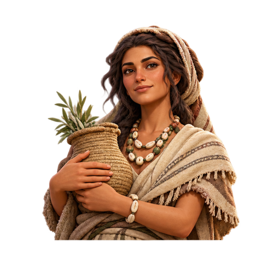 | 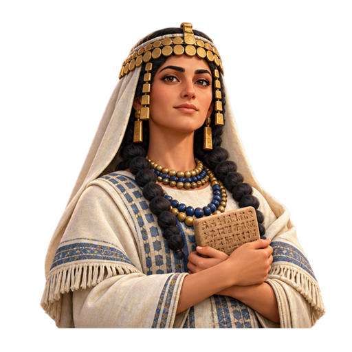 | 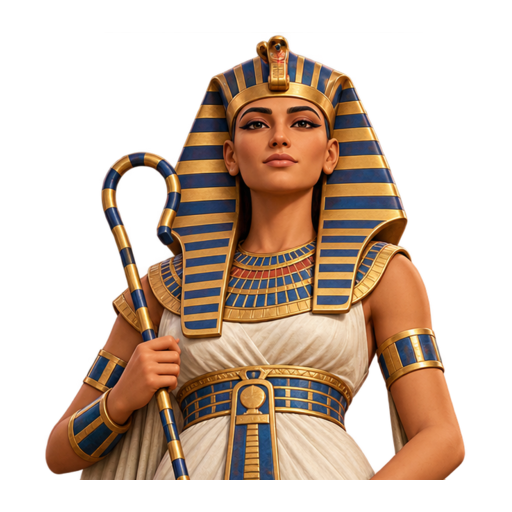 | 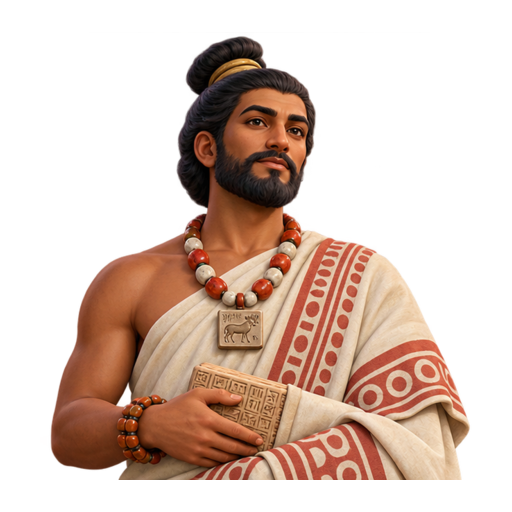 |

### Уникальные районы стартовых культур

| Иерихон · Башня источника | Шумер · Зиккуратовый архив | Египет · Двор нилометра | Инд · Большая купальня |
|---|---|---|---|
| 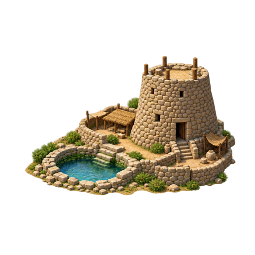 | 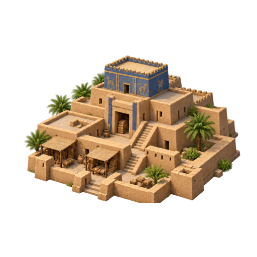 | 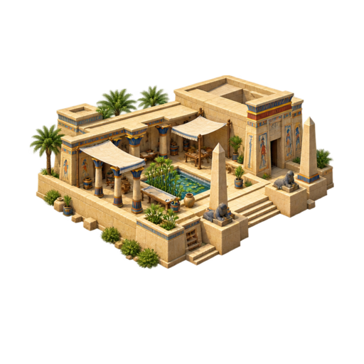 | 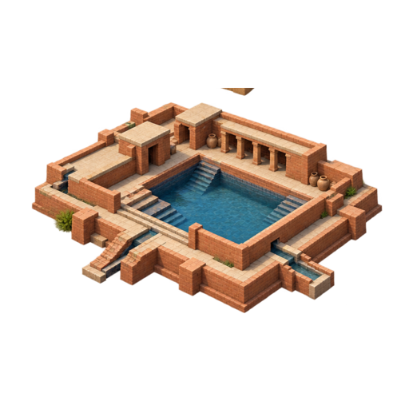 |

У всех четырёх сторон также свой вид и небольшой игровой бонус учебного района: устная передача знаний в круге общины усиливает престиж, Эдубба даёт знание, Пер-Анх повышает образование, а Дом печати — доход казны. Для Иерихона и Инда это художественные игровые интерпретации, не доказанные археологические школы.

| Круг памяти · Иерихон | Эдубба · Шумер | Пер-Анх · Египет | Дом печати · Инд |
|---|---|---|---|
| 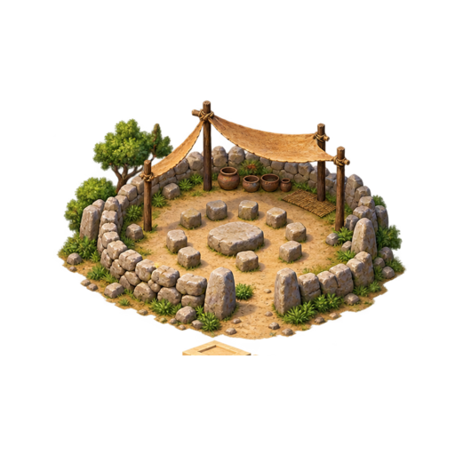 | 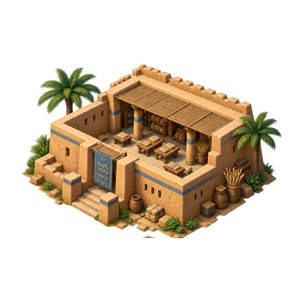 | 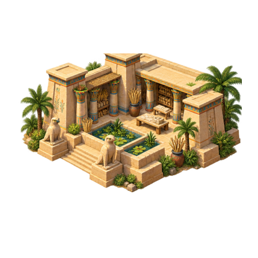 | 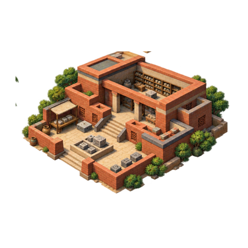 |

Центр города занимает один гекс, завершённые здания — отдельные районы. Район на карте использует эпохальный спрайт из текущего атласа; так развитие здания и общий архитектурный образ нации видны одновременно.

## Просмотр архитектуры по эпохам

В репозитории лежат отдельные атласы зданий для всех пяти эпох. Каждый атлас содержит 16 именованных спрайтов и импортируется в проект отдельно.

Эпоха общин

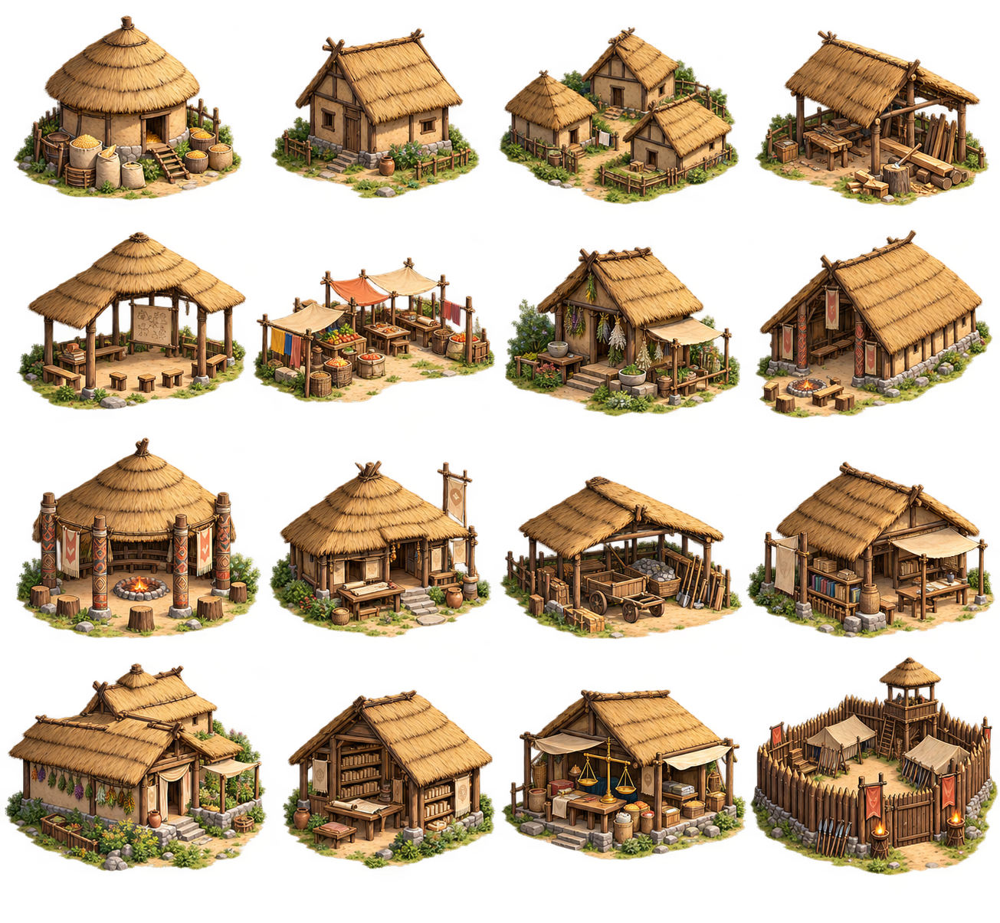

Эпоха городов

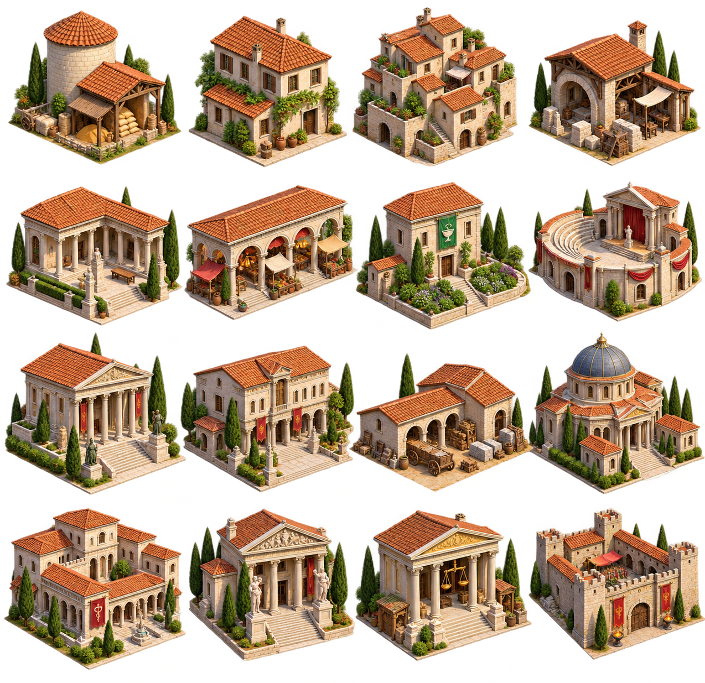

Эпоха связанных земель

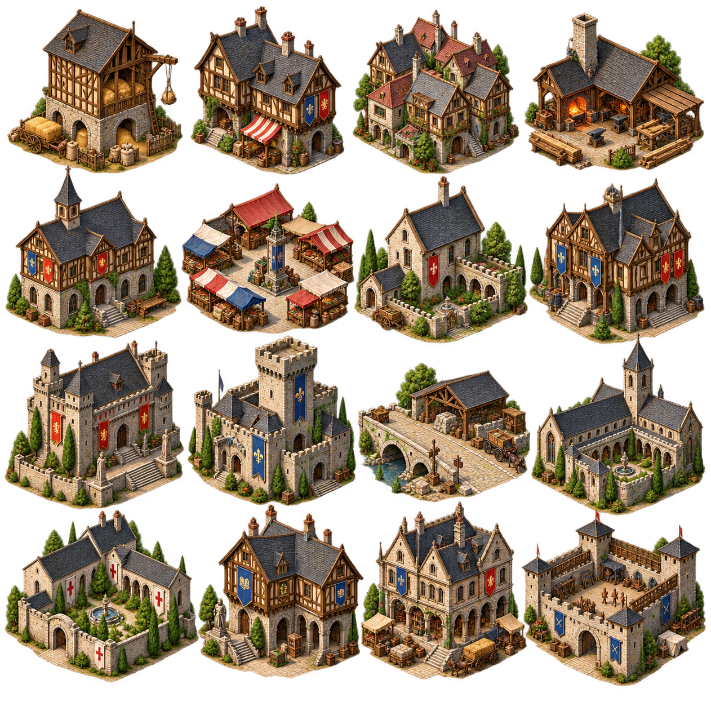

Эпоха индустрии

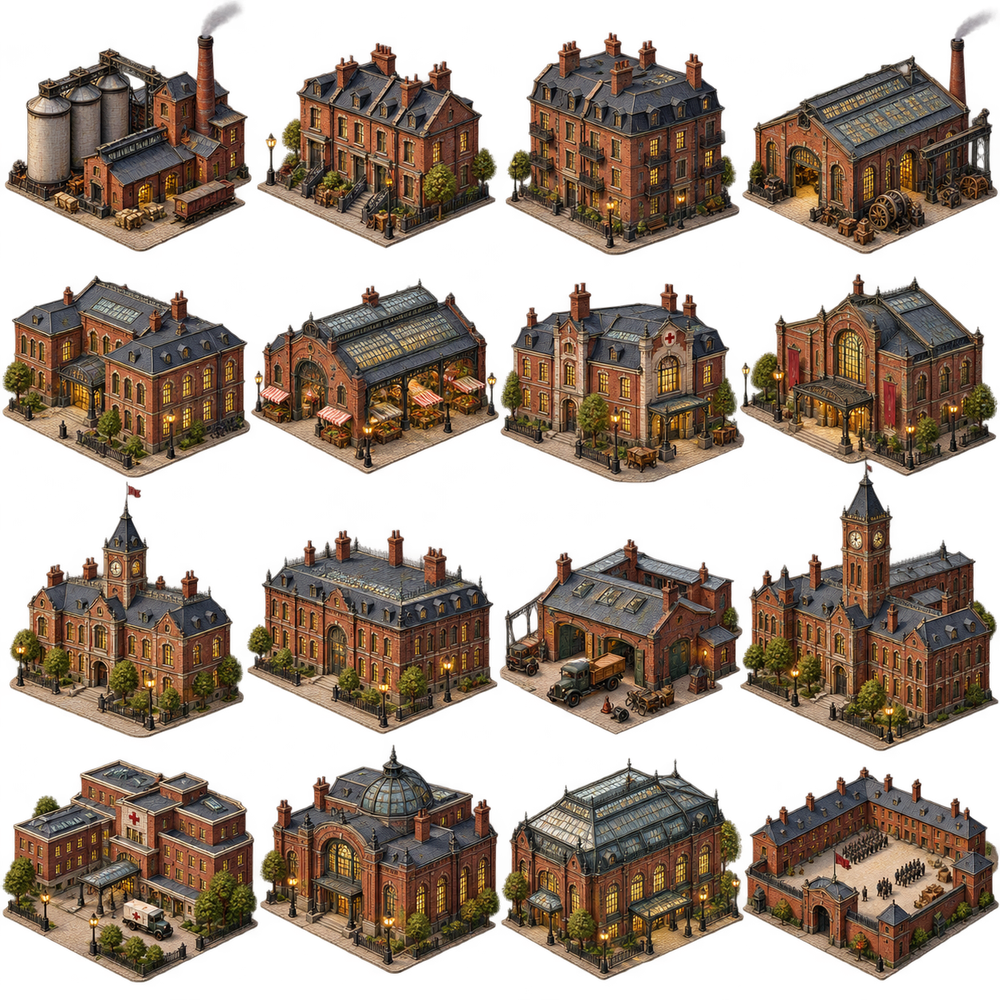

Эпоха синтеза

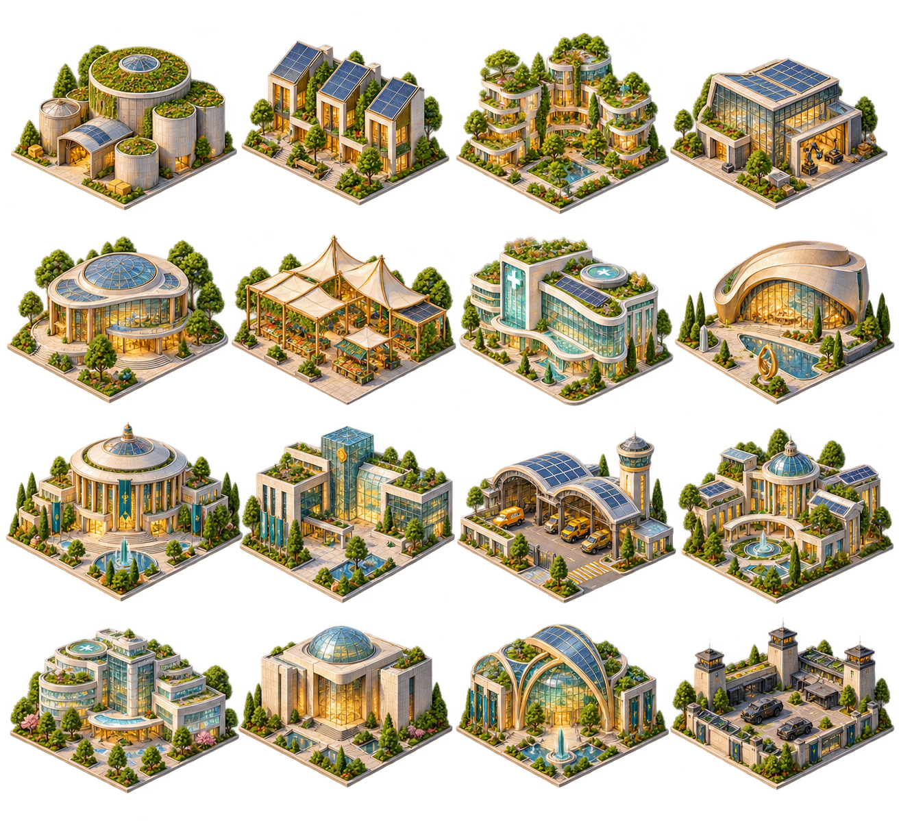

Отряды всех эпох

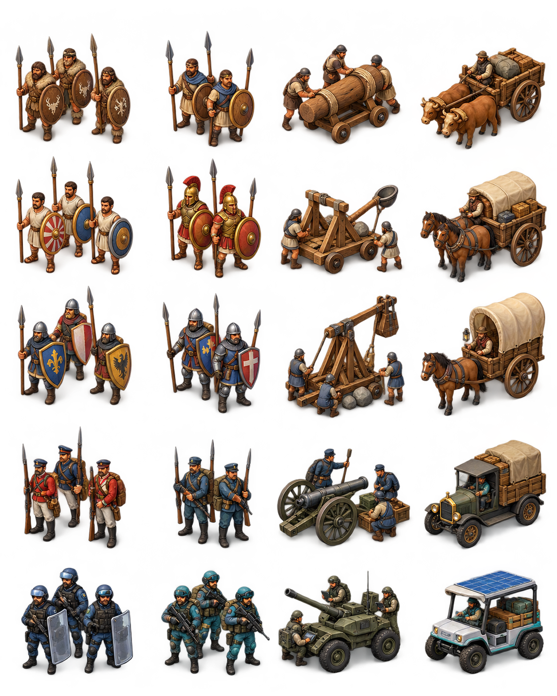

PNG импортируются как Sprite через `Assets/Game/Editor/ArtAssetImporter.cs`, в том числе нарезаются из атласов по отдельным именованным ячейкам. Местность рисуется на открытых клетках карты; вид городского значка, отрядов и списка строительства зависит от текущей эпохи цивилизации. Музыку можно выключить в меню и менять её громкость в настройках.

## Концепт экранов

Это сгенерированный визуальный ориентир для меню, первых ходов, середины партии и экрана победы; это не снимок запущенной Unity-сборки.

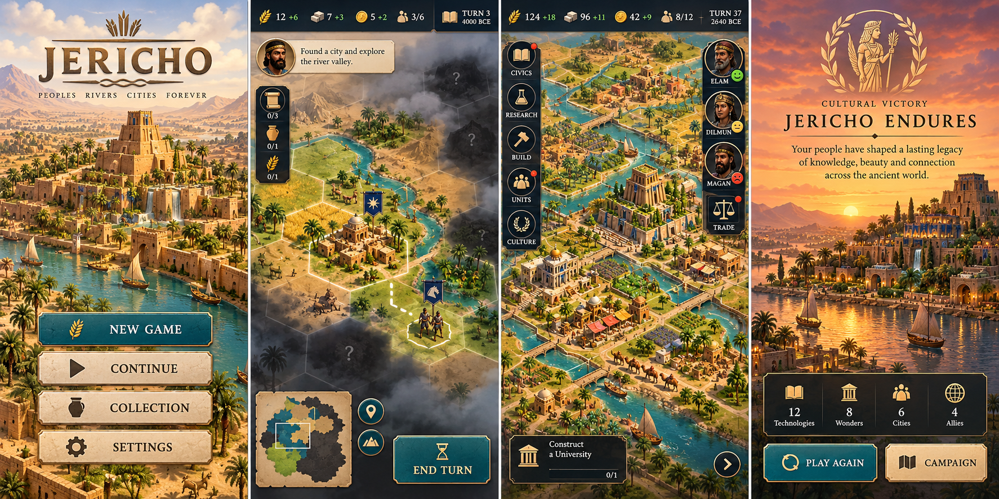

Иллюстрации созданы генератором изображений, а музыка и эффекты синтезированы локально из оригинальных мелодических и звуковых слоёв. В проверяемые атласы входят 148 спрайтов, включая 80 эпохальных зданий и 20 эпохальных отрядов; отдельно добавлены четыре портрета персонажей, четыре культурных учебных центра и четыре уникальных района. В Unity откройте **JERICHO → Проверить игровые материалы**; проверка сверяет атласы, 11 фоновых изображений, портреты, учебные центры, уникальные районы, эмблему, иконку, пять музыкальных тем и 12 эффектов.
