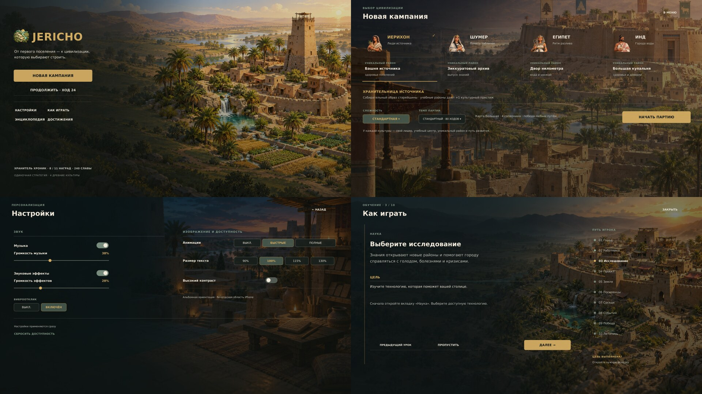
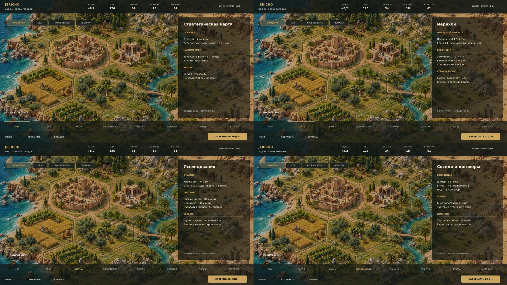
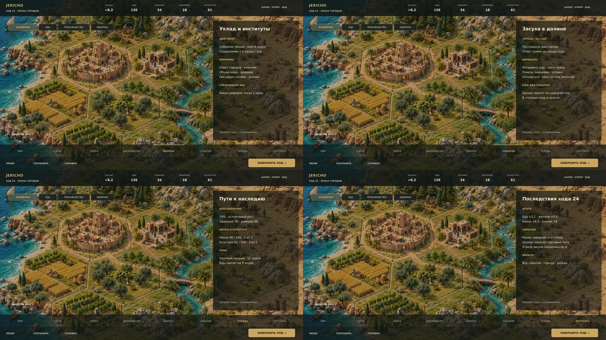
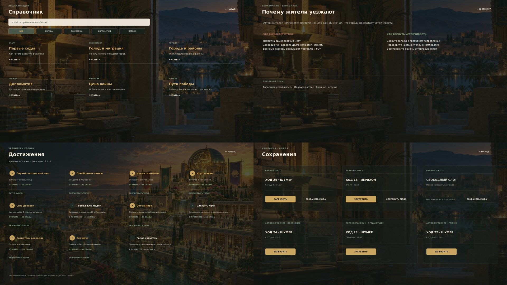
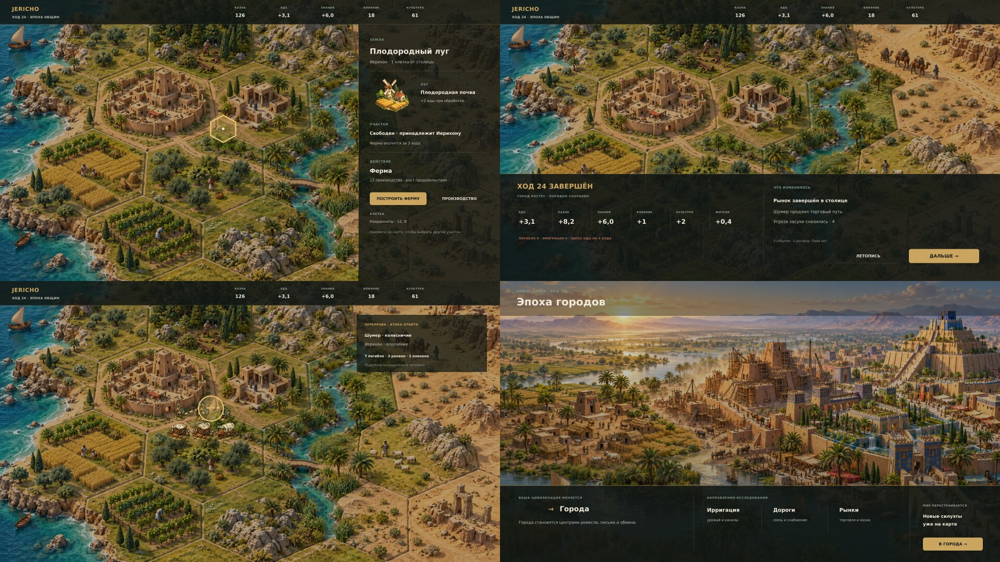
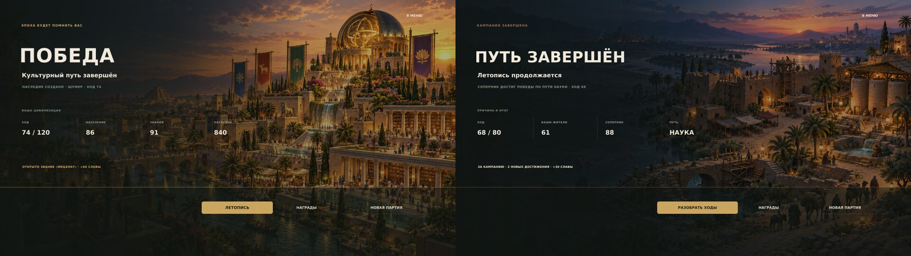

# JERICHO · альбомные экраны

Это новая редакция концептов интерфейса 16:9. Иллюстрации игры сохранены; заново собраны композиция и управление. Фоны остаются видны, основная поверхность — прозрачная, текст короткий, для действий используются конкретные переключатели, шкалы и выборы.

Это целевые альбомные концепты, а не снимки запущенной Unity-сборки. Карта остаётся игровой сценой под выбором клетки, сводкой хода и боевыми анимациями. Результат боя не открывает отдельное окно. Runtime-код для этих состояний обновлён; фактическое положение в Unity ещё нужно подтвердить в Play Mode на Mac пользователя.

Экраны 18–20 показывают расширенный отчёт хода, компактный итог столкновения и новые направления эпохи. Финалы 21–22 переработаны как сцены поверх полноэкранного арта: победа показывает наследие и награду, поражение — победителя и путь соперника; оба предлагают летопись, достижения и новую партию без центрального модального окна.

## Общие доски

Каждая доска показывает до четырёх экранов. Для внимательного просмотра откройте JPG-превью или SVG отдельного экрана из таблицы ниже.

## Все экраны

| Экран | JPG-превью | Векторный исходник |
|---|---|---|
| Главное меню | [JPG](01-main-menu.jpg) | [SVG](01-main-menu.svg) |
| Новая кампания | [JPG](02-campaign-setup.jpg) | [SVG](02-campaign-setup.svg) |
| Настройки | [JPG](03-settings.jpg) | [SVG](03-settings.svg) |
| Обучение | [JPG](04-tutorial.jpg) | [SVG](04-tutorial.svg) |
| Мир | [JPG](05-world.jpg) | [SVG](05-world.svg) |
| Город | [JPG](06-city.jpg) | [SVG](06-city.svg) |
| Наука | [JPG](07-research.jpg) | [SVG](07-research.svg) |
| Дипломатия | [JPG](08-diplomacy.jpg) | [SVG](08-diplomacy.svg) |
| Законы | [JPG](09-laws.jpg) | [SVG](09-laws.svg) |
| События | [JPG](10-events.jpg) | [SVG](10-events.svg) |
| Победа | [JPG](11-victory.jpg) | [SVG](11-victory.svg) |
| Летопись | [JPG](12-chronicle.jpg) | [SVG](12-chronicle.svg) |
| Энциклопедия | [JPG](13-encyclopedia-index.jpg) | [SVG](13-encyclopedia-index.svg) |
| Статья энциклопедии | [JPG](14-encyclopedia-article.jpg) | [SVG](14-encyclopedia-article.svg) |
| Достижения | [JPG](15-achievements.jpg) | [SVG](15-achievements.svg) |
| Сохранения | [JPG](16-save-manager.jpg) | [SVG](16-save-manager.svg) |
| Карточка клетки | [JPG](17-hex-selection.jpg) | [SVG](17-hex-selection.svg) |
| Итог хода | [JPG](18-turn-resolution.jpg) | [SVG](18-turn-resolution.svg) |
| Анимация боя | [JPG](19-battle-animation.jpg) | [SVG](19-battle-animation.svg) |
| Переход эпохи | [JPG](20-era-transition.jpg) | [SVG](20-era-transition.svg) |
| Финал победы | [JPG](21-campaign-result.jpg) | [SVG](21-campaign-result.svg) |
| Финал поражения | [JPG](22-campaign-defeat.jpg) | [SVG](22-campaign-defeat.svg) |

`map-art.png` — иллюстрация целевого вида карты. Игровая карта в текущем проекте строится на интерактивных гексах; эта иллюстрация не выдаётся за кадр из текущего Unity runtime.

Правила интерфейса и критерии сверки реализации описаны в [дизайн-спецификации интерфейса](../Jericho_UI_Design_Spec_ru.md).
